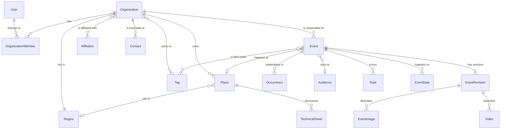

# Design 1 — The data model

How the BKa agenda is represented in We.Publish's database. This is the first of four design
documents and the one the others rest on; the [API](02-api.md), the
[editor](03-editor.md) and the [migration](04-migration.md) all take their shape from what is
decided here.

Grounded in [`../research/`](../research/) and constrained by [`../decisions.md`](../decisions.md).
Where this document and the research disagree, the decision log wins.

---

## 1. What we are modelling

BKa is a cultural agenda. Someone who runs a venue or a festival publishes events; the public
browses them by date, place, category and accessibility. Stripped of its implementation, the
domain is six nouns:

| Noun | What it is | BKa rows |
| --- | --- | --- |
| **Organisation** | A body that runs events — a theatre company, a festival, a collective | 781 |
| **Place** | A venue where events happen; usually belongs to an organisation | 1,369 |
| **Event** | Something happening, with one or more dates | 39,978 |
| **Occurrence** | One concrete date-time slot of an event | 128,489 |
| **Person** | Someone who maintains an organisation's events | 670 |
| **Taxonomy** | Category, region, audience, affiliation | 53 |

Everything else — rates, ticketing links, images, videos, contacts, technical sheets — hangs off
one of those.

Two of these have no equivalent in We.Publish at all. There is no organisation, and no notion of
a user belonging to one: `organization` returns **zero hits** in `schema.prisma` and zero across
`libs/**/*.ts`. That absence, not the event model, is the largest piece of new work, because
[D3](../decisions.md), [D4](../decisions.md), [D5](../decisions.md) and
[D8](../decisions.md) all stand on it.

That was the state before the port. The data model in this document is now built except the
`Video` entity, the technical-sheet `Document` reference on `Place`, the ProInfirmis sync and the
Agenda-Admin role (§11.2, §9, §13): `Region`, `Organization`, `OrganizationMember` and membership
on the session (§8), then places, audiences, affiliations, contacts, events, revisions, dates,
occurrences, images and rates (`libs/api/prisma/schema.prisma:2379-2780`, migration
`20261023140000_replace_events_with_agenda`). Where the build differs from a sketch below, the
section says so.

---

## 2. Shape of the solution



Read it as three layers:

1. **Who** — `User`, `Organization`, and the membership between them. New to We.Publish.
2. **Where** — `Place` and `Region`, with accessibility data from ProInfirmis.
3. **What** — `Event`, its revisions, and the occurrences its schedule expands into.

What an editor *writes* lives on the **revision** — the name, the print blurb, the body blocks and
the images. What the event *is* lives on the **entity** — when it happens, where, who runs it, what
it costs, how it is filed, whether it is still on. That division is [D24](../decisions.md), and it is the
single most consequential choice in this document.

---

## 3. Naming and placement

Per [D9](../decisions.md) and [D12](../decisions.md): one schema file, dotted table names.

Every new table is `@@map`ped under the `events.` prefix, which is already the house convention —
the schema has 57 dotted names today, including `events.tagged-events` on the implementation we
are deleting.

| Model | Table |
| --- | --- |
| `Organization` | `events.organizations` |
| `OrganizationMember` | `events.organizations.members` |
| `Place` | `events.places` |
| `Event` | `events.events` |
| `EventRevision` | `events.events.revisions` — **one table** |
| …draft / pending / published | `events.events.revisions.draft` / `.pending` / `.published` — **SQL views over that table**, as `articles.revisions` does |
| `Occurrence` | `events.occurrences` |
| `Region` / `Audience` / `Affiliation` | `events.regions` / `.audiences` / `.affiliations` |
| *(categories)* | none — reuses the platform `tags` table. §10 |
| `Rate` | `events.rates` |
| `Contact` | `events.contacts` |
| `Video` | `videos` — platform media, **not** `events.`-prefixed. §11.2 |

All of it goes in one contiguous, delimited block at the bottom of
`libs/api/prisma/schema.prisma` — roughly 400–600 lines.

New ids are UUIDv7 generated by Postgres, `@id @default(dbgenerated("uuidv7()"))`
(`.claude/docs/graphql-prisma.md:37-40`), as the built `Region`, `Organization` and `ApiToken`
models already do. The sketches below follow that.

---

## 4. The decisive simplification: sub-events disappear

### 4.1 What BKa does

`Event` is abstract with `SINGLE_TABLE` inheritance on a `type` discriminator:
**24,703 `mainevent` + 15,275 `subevent` rows in one table.** A recurring event is a main event
plus one sub-event per date. `OnFlushEventListener` then copies **fourteen fields and the whole
category relation** from the parent down to every child on every save, and separately deletes and
regenerates all 128,489 occurrence rows.

So a sub-event genuinely owns only four things — `dateFrom`, `dateTo`, `openingTime`, `slug` —
and inherits everything else by continuous synchronisation.

### 4.2 What we do instead

**Sub-events are not ported.** An event has dates; dates are not events.

```
BKa                                   We.Publish
─────────────────────────────────     ─────────────────────────────────
event (mainevent)  24,703       →     events.events               ~24,703
event (subevent)   15,275       →     (dates on the event)
event_occurrence  128,489       →     events.occurrences         ~128,489
```

This removes a whole class of bug. The fourteen-field copy-down exists only because the children
are rows that can drift from their parent; with dates as data rather than entities, there is
nothing to synchronise and nothing to drift.

### 4.3 Why BKa has both, and why that settles it

BKa maintains sub-events *and* occurrences. The data shows why, and shows that only one is a real
concept:

| Check | Result |
| --- | --- |
| Occurrences per sub-event | **exactly 1.00** (15,275 : 15,275) |
| Occurrences on the parent of an explicit-list event | **1** — its own first date |
| Child occurrences that coincide with a parent occurrence | **30 of 15,275** |
| Children that have drifted from their parent despite the copy-down | **67** |

The parent's `date_from`/`date_to` columns hold exactly **one span**. A second date had nowhere to
go, so it went into another row of the same table — and being an event row, it inherited an id, a
slug, and the obligation to keep fourteen fields synchronised forever. The 67 drifted children are
what that obligation costs when it is not perfectly met.

A sub-event is therefore a **storage workaround for a single-span column**, not a domain concept.
Collapsing it is not a simplification we are imposing on the model; it is the removal of an
accident, leaving the one date mechanism BKa already had.

### 4.4 The cost, and how it is paid

Sub-events are **addressable in the public API** — v1 and v2 both return them as first-class
members with their own ids and slugs. Collapsing them breaks any client holding a sub-event id.

Since [D31](../decisions.md) that cost lands on the clients, along with everything else on the old
API: BKa's v1/v2 API is switched off at cutover, so nothing resolves old sub-event ids afterwards.

- Each explicit date may still carry a `legacyEventId`, preserved onto the occurrence it produces.
  It now serves only the migration itself, not a public lookup.
- The id ledger in [design 4](04-migration.md) is migration-only for the same reason.
- `openingTime` travels with the date onto the occurrence (§5.2), so nothing is lost in the collapse.

---

## 5. Dates: a rule *or* a list

BKa has two date mechanisms behind one UI, and the second is easy to miss.

| BKa | Means | Events |
| --- | --- | --- |
| `schedule = continuous` | One span, start to end | 23,893 |
| `recurrence = week` | Repeat on chosen weekdays within a span | 810 |
| `recurrence = none` *(recurrent)* | **An arbitrary list of typed dates, each with its own times** | the 15,275 sub-events' parents |

The third is not derivable from anything — the organiser typed those dates. All three forms are
facts about *when the event happens*, so per [D24](../decisions.md) they live on the **entity**,
not the revision.

```prisma
enum EventScheduleType {
  Continuous   // one span
  Weekly       // rule: weekdays within a span
  Explicit     // a typed list of dates
}
```

These fields belong to `Event` (shown whole in §6):

```prisma
// on model Event
  scheduleType EventScheduleType
  // Continuous + Weekly
  dateFrom     DateTime? @db.Timestamptz(3)
  dateTo       DateTime? @db.Timestamptz(3)
  weekDays     Int[]              // ISO 1-7, no repeats (D43); Weekly needs at least one (D38)
  openingTime  String?            // "HH:MM", optional door time
  // Explicit
  dates        EventDate[]

model EventDate {
  id         String   @id @default(dbgenerated("uuidv7()"))
  createdAt  DateTime @default(now()) @db.Timestamptz(3)
  modifiedAt DateTime @updatedAt @db.Timestamptz(3)

  eventId       String
  dateFrom      DateTime @db.Timestamptz(3)
  dateTo        DateTime @db.Timestamptz(3)
  openingTime   String?
  sortOrder     Int
  legacyEventId BigInt?  // the BKa sub-event this came from

  event Event @relation(fields: [eventId], references: [id], onDelete: Cascade)

  @@index([eventId])
  @@map("events.events.dates")
}
```

There is no `startTime`/`endTime` ([D39](../decisions.md)). The time of day lives inside
`dateFrom`/`dateTo`: a Weekly series starts each sitting at `dateFrom`'s wall-clock time and ends it
at `dateTo`'s, on the next day when the end is earlier than the start. BKa has no separate time
columns either (`../research/bka-01-data-model.md:388-390`).

A Weekly schedule with no weekdays is **rejected on input** and **tolerated in storage**
([D38](../decisions.md)): BKa has rows with `[]`, and expansion turns them into no occurrences
rather than failing.

All three forms expand through **one function** to the same output: a list of
`{dateFrom, dateTo, openingTime, legacyEventId}`. Continuous expands to one occurrence; Weekly walks
the span; Explicit maps its list. Having a single expansion path is what keeps the occurrence table
honest.

That function is built: `expandOccurrences(schedule: EventSchedule): ExpandedOccurrence[]` in
`libs/event/schedule` (`@wepublish/event/schedule`,
`libs/event/schedule/src/lib/expand-occurrences.ts:100-115`). It takes the schedule fields above as
a plain value (`event-schedule.ts:3-25`), not a Prisma row, so the API, the migration and a repair
command can all call it. The same library holds the two-year horizon (`schedule-horizon.ts`) and
the input check that combines it with the weekday rules (`validateScheduleInput`,
`schedule-input.ts:19-28`).

### 5.1 Timezones — the trap

BKa pins `Europe/Zurich` in a custom Doctrine type and expands by adding `P1D` **in that zone**,
which preserves the **wall clock across DST**: a Saturday 11:00 series stays 11:00 on both sides
of the March change, even though the UTC offset moves from +01 to +02.

We.Publish runs `TZ=UTC` everywhere. A naive UTC loop adding 24 hours produces 10:00 for half the
year, and nobody notices until spring.

**The expansion must be done in `Europe/Zurich` and converted to UTC for storage.** Storage stays
`Timestamptz` as everywhere else in this schema; only the arithmetic is zoned. This needs a test
that expands a weekly series across the last Sunday in March and asserts the local time is stable.

### 5.2 Occurrences

```prisma
model Occurrence {
  id         String   @id @default(dbgenerated("uuidv7()"))
  createdAt  DateTime @default(now()) @db.Timestamptz(3)
  modifiedAt DateTime @updatedAt @db.Timestamptz(3)

  eventId       String
  dateFrom      DateTime @db.Timestamptz(3)
  dateTo        DateTime @db.Timestamptz(3)
  openingTime   String?  // door time; BKa's occurrence table has no such column
  legacyEventId BigInt?

  event Event @relation(fields: [eventId], references: [id], onDelete: Cascade)

  @@index([eventId])
  @@index([dateFrom])
  @@index([dateTo])
  @@map("events.occurrences")
}
```

Note `openingTime`, which BKa's `event_occurrence` table does **not** have — it lives only on the
event/sub-event row. 2,434 sub-events carry one, so collapsing into BKa's occurrence shape unchanged
would silently drop the door time for ~2,400 dates. It is carried here instead.

Derived state, owned by the entity ([D10](../decisions.md)).

**As built ([D45](../decisions.md#d45--occurrences-are-written-whenever-the-schedule-is-saved)), awaiting Karl's confirmation:**
occurrences are rewritten on **every save that changes the schedule** — `createEvent`,
`updateEvent`, `duplicateEvent` — and re-synced on `publishEvent`. `unpublishEvent` keeps them.
That is BKa's on-save behaviour after all. It follows from D24: the schedule is a fact on the
entity, so a date fix has to reach the public agenda without publishing. Drafts are not exposed by
this, because the public agenda joins `publicEventsWhere` on the event. It also closes the
scheduled-publication gap: the rows exist before `publishAt`, and the published view switches over
at that instant. `syncOccurrences` (`libs/event/api/src/lib/event-occurrences.ts:39-70`) compares the
stored rows with `expandOccurrences(schedule)` through `sameOccurrences` and only deletes and
re-inserts when they differ, inside the caller's transaction. The first design said "regenerated on
publish and unpublish, not on every save", with drafts expanded in memory. That is superseded
here if Karl confirms.

Two guards this needs: a repair command (BKa's `EventsCalculateOccurrencesCommand` equivalent, not
built yet) and a test asserting re-expansion is idempotent (built, `event-occurrences.spec.ts`).

**Unbounded recurrences are capped at input** ([D15](../decisions.md)). An event's last date must fall
on or before the Zurich calendar day two years after the save ([D40](../decisions.md)); expansion
then materialises everything the schedule describes. There is **no scheduled job and no refreshing
window** — expansion stays a pure,
idempotent function of the event's schedule (which sits on the entity since
[D24](../decisions.md)), and no occurrence ever appears that an organiser did not type.

The horizon counts **whole days** ([D40](../decisions.md)). `lastSchedulableDay(now)` is today's
Zurich date two years on, with 29 February falling back to the 28th, and `scheduleHorizon(now)` is
the last millisecond of that day (`libs/event/schedule/src/lib/schedule-horizon.ts:19-41`). Saved on
23 October 2026, an event may end at any time on 23 October 2028 up to 23:59; an end at 00:00 on the
24th already belongs to the next day and is refused. This is the date the editor copy in
[design 3](03-editor.md) §5 shows.

Twenty BKa events run past 2030 and one to 2099 (12,374 occurrence rows on its own). Those are
clipped at migration and reported, not silently shortened. The ongoing cost is that an open-ended
weekly series needs an organiser back every two years, so the editor warns before an event's last
occurrence passes rather than letting it drop out of the agenda unannounced.

---

## 6. Revisions

Events adopt the article mechanism unchanged: an entity row, **one** revision table, and three SQL
**views** over it (`draft`, `pending`, `published`) that the services read through.

This is worth stating precisely because it is easy to misread as four tables. In the existing
schema there is a single `articles.revisions` table (`schema.prisma:48`); `articles.revisions.published`,
`.pending` and `.draft` are views over it, each selecting the one revision that currently holds
that role. Events do exactly the same: one `events.events.revisions` table, three views.

```prisma
model Event {
  id         String   @id @default(dbgenerated("uuidv7()"))
  createdAt  DateTime @default(now()) @db.Timestamptz(3)
  modifiedAt DateTime @updatedAt @db.Timestamptz(3)

  slug   String?     // not unique: unique among published events, checked in the service (§6.2)
  status EventStatus @default(Confirmed)

  organizationId String?       // nullable — D20; 19% of BKa events have none
  placeId        String?
  ownerId        String?       // the user responsible; drives D3 notifications and owner access (D35)

  // the schedule — §5
  scheduleType EventScheduleType
  dateFrom     DateTime? @db.Timestamptz(3)
  dateTo       DateTime? @db.Timestamptz(3)
  weekDays     Int[]
  openingTime  String?

  audienceId String?   // one per event — §10.2

  ticketingUrl String?                  // D52; design 2 §4; BKa's scalar ticketing link (§12)
  showInPrint  Boolean @default(false)  // D52; design 2 §2.2 filter

  // the platform SEO/social set — §7.1
  seoTitle               String?
  seoDescription         String?
  socialMediaTitle       String?
  socialMediaDescription String?
  socialMediaImageID     String?

  publishedAt DateTime? @db.Timestamptz(3)
  firstDateAt DateTime? @db.Timestamptz(3)
  lastDateAt  DateTime? @db.Timestamptz(3)

  reviewRequestedAt   DateTime? @db.Timestamptz(3)   // D5
  reviewRequestedById String?

  legacyId         BigInt?  @unique
  legacyProposedBy Json?    // D6/D8 provenance

  organization Organization? @relation(fields: [organizationId], references: [id], onDelete: SetNull)
  place        Place?        @relation(fields: [placeId], references: [id], onDelete: SetNull)
  owner        User?         @relation("eventOwner", fields: [ownerId], references: [id], onDelete: SetNull)
  audience     Audience?     @relation(fields: [audienceId], references: [id], onDelete: SetNull)
  socialMediaImage Image?    @relation("eventSocialMediaImage", fields: [socialMediaImageID], references: [id], onDelete: SetNull)
  tags         TaggedEvents[] // §10.1 — BKa called these categories; explicit join, kept
  rates        Rate[]        // §11
  dates        EventDate[]
  occurrences  Occurrence[]
  revisions    EventRevision[]
  published    EventRevisionPublished?   // the three views, as Article has them
  pending      EventRevisionPending?
  draft        EventRevisionDraft?

  @@index([slug])
  @@index([organizationId])
  @@index([reviewRequestedAt])
  @@index([status])
  @@index([firstDateAt])
  @@map("events.events")
}

model EventRevision {
  id        String   @id @default(dbgenerated("uuidv7()"))
  createdAt DateTime @default(now()) @db.Timestamptz(3)

  eventId String

  name             String
  printDescription String?   // max 256 chars, written for print — §7
  blocks           Json
  descriptionText  String @default("")   // plain text of the richtext blocks — search and the 6,400 rule

  publishedAt DateTime? @db.Timestamptz(3)
  archivedAt  DateTime? @db.Timestamptz(3)
  userId      String?   // who wrote this revision

  event Event @relation(fields: [eventId], references: [id], onDelete: Cascade)
  user  User? @relation(fields: [userId], references: [id], onDelete: SetNull)

  @@index([publishedAt])
  @@index([eventId, createdAt(sort: Desc), id(sort: Desc)])
  @@map("events.events.revisions")
}
```

As built: `libs/api/prisma/schema.prisma:2575-2700`, abridged above (the built model also indexes
`createdAt`, `modifiedAt`, `placeId`, `ownerId`, `audienceId`, `publishedAt` and `lastDateAt`, and
`reviewRequestedBy` is a `SetNull` relation to `User`). The views
`events.events.revisions.published` / `.pending` / `.draft` and their partial indexes are copied
from the article migration into `20261023140000_replace_events_with_agenda`. Prisma does not
manage them, so a later `prisma migrate diff` must be checked for attempts to drop them.

`descriptionText` is written by `createEvent`, `updateEventContent` and `duplicateEvent` from
`blocksPlainText` (`libs/event/schedule/src/lib/blocks-plain-text.ts`). It is new: the description
lives in `blocks` JSON, which cannot be indexed sensibly, and `blocks::text` would also match JSON
keys. It is [D51](../decisions.md#d51--the-revision-keeps-its-description-as-plain-text-for-search), awaiting Karl's confirmation.

`archivedAt` is not decoration. The platform's draft view is
`WHERE "archivedAt" IS NULL AND "publishedAt" IS NULL`
(`libs/api/prisma/migrations/20250519153015_add_archived_at_revisions/migration.sql`), so a revision
table without the column cannot reuse the three-view mechanism as written — superseded drafts would
stay in the draft view forever.

Per [D24](../decisions.md), the line is **prose versus fact**. `EventRevision` carries only what an
editor composes — the name, the print blurb, the body blocks and the chosen images (§11). Everything that
states what the event *is* — when, where, who runs it, what it costs, how it is classified, whether
it is still on — sits on `Event` and changes the moment it is saved.

`EventRevision` has `createdAt` but no `modifiedAt`, matching `ArticleRevision`, `PageRevision` and
`CommentsRevisions` ([D25](../decisions.md)).

This makes `EventRevision` markedly thinner than `ArticleRevision`. That is the intended outcome:
an event is mostly structured facts with a paragraph attached, where an article is mostly prose.

### 6.1 Status columns

BKa's two status columns are not the same kind of thing and only one of them is a publication state:

| BKa column | Values | Becomes |
| --- | --- | --- |
| `publication_status` | `draft` / `to_validate` / `publish` | the revision system — `to_validate` folds into draft ([D1](../decisions.md)) |
| `event_status` | `confirmed` / `canceled` / `postponed` / `full` | a field on the **entity** ([D24](../decisions.md)) |

`event_status` answers "is this still happening?" — the one field whose whole purpose is to be true
*right now*. On the revision, cancelling would mean composing a revision and publishing it. It sits
on the entity, so a cancellation takes effect the moment it is saved:

```prisma
enum EventStatus {
  Confirmed @map("confirmed")
  Cancelled @map("cancelled")
  Postponed @map("postponed")
  SoldOut   @map("soldOut")
}
```

BKa's four values are `confirmed` / `canceled` / `postponed` / `full`
(`research/bka-08-event-domain-logic.md:681-684`), labelled Bestätigt / Annuliert / Verschoben /
Ausverkauft. Two of those wire spellings differ from the names above — **`canceled` with one `l`,
and `full` rather than `soldOut`** — so the migration maps them on the way in:

| We.Publish | BKa wire |
| --- | --- |
| `Confirmed` | `confirmed` |
| `Cancelled` | `canceled` |
| `Postponed` | `postponed` |
| `SoldOut` | `full` |

There is no `Rescheduled`. It existed only in We.Publish's old enum as a schema.org borrowing;
BKa has no such state and `Event::getEventStatusList()` would reject it
(`research/bka-04-api-v2-apiplatform.md:424`).

**Status is public.** `event_status` sits in BKa's public serialization groups including the
trimmed `api:occurrence:read-lite-collection` (`research/bka-04-api-v2-apiplatform.md:424,461`),
so the website renders it — a badge on the list item, which propagates for free to the
`EventBlock` and the teasers because they all render through `EventListItem`. An agenda that
silently lists a sold-out event is worse than one that says so.

(Counts differ between research passes — 33,831/366/65/17 at `bka-08:681-684` against
39,452/434/72/20 recorded earlier here. Almost certainly mainevents versus all events including
subevents; worth reconciling before the migration report quotes a number, not before anything
is built.)

### 6.2 Slugs — a real conflict

BKa: `slug` is unique across **all 39,978 events**, drafts included, with `-1`/`-2` collision
suffixes. We.Publish: slugs are unique **only among published rows**; any number of drafts may
share one.

These rules are incompatible, and the We.Publish rule is the right one to keep — it is what makes
drafts cheap. **As built** ([D50](../decisions.md#d50--event-slugs-are-unique-among-published-events-only)), the column is non-unique and indexed. `createEvent`, `updateEvent` and
`publishEvent` refuse a slug that another published event already uses, and a slug lookup prefers
the published event (`libs/event/api/src/lib/event.service.ts:184-191,903-926`). Two drafts may
share a slug, but the second one to publish is refused. `Article` has no such check.

The consequence lands on the migration: 39,978 BKa slugs must be de-duplicated
against the published-only constraint. Old slugs no longer need a lookup: the compatibility stub
that would have resolved them is gone ([D31](../decisions.md)).

---

## 7. Content: blocks and the description

Per the brief, event body content uses the block framework.

`EventRevision.blocks Json` mirrors `ArticleRevision`. BKa's description — up to 6,400 characters
of HTML, stored entity-encoded inside a JSON `labels` column — converts to a **single richtext
block** at migration, and the editor may add more blocks afterwards.

Two fields do **not** become blocks, because they are not body content:

- **`printDescription`** — max 256 characters, plain text, written for the print edition. A scalar
  field. 25,164 events have one.
- **`name`** — max 130 characters. A scalar field.

The conversion is the interesting part: the source is HTML-entity-encoded HTML inside JSON, so it
must be decoded, parsed, and mapped to Slate nodes, with anything unmappable preserved rather than
silently dropped. Specified in [design 4](04-migration.md).

---

### 7.1 SEO and social come from the platform, not from BKa

BKa has a single `og_image` column with no values in it. The temptation is to read that as "events
need no social metadata" and drop it. The right reading is that BKa never built the feature.

Every other We.Publish content type has the same five fields, and `ArticleRevision` and
`PageRevision` spell them identically. An event takes the same five fields:

| Field | |
| --- | --- |
| `seoTitle`, `seoDescription` | search engines |
| `socialMediaTitle`, `socialMediaDescription`, `socialMediaImageID` | Open Graph and friends |

The five field *names* are taken verbatim so the shape is recognisable; only their placement
differs.

Two article-only fields are **not** taken: `canonicalUrl`, which exists for peered articles and has
no event equivalent (`PageRevision` does not have it either), and `socialMediaAuthors`, since events
have no authors.

**They sit on the `Event`, not the revision.** This is a deliberate divergence from
`ArticleRevision` and `PageRevision`, which both version them. The fields are descriptive metadata
about the event rather than the body an editor writes, and [D24](../decisions.md)'s line puts
metadata on the entity: correcting an Open Graph title should not require composing and publishing
a revision, for the same reason cancelling an event should not.

Nothing migrates into them; they start empty and the editor fills them in over time.

---

## 8. Organisations, membership and ownership

New to We.Publish, and the foundation for every permission decision. **Built**: the snippet matches
`libs/api/prisma/schema.prisma:2395-2447` and migration `20261023120000_add_event_organizations`.
The relations to places, events, contacts, tags and affiliations arrived with their models in
`20261023140000_replace_events_with_agenda`.

```prisma
model Organization {
  id         String   @id @default(dbgenerated("uuidv7()"))
  createdAt  DateTime @default(now()) @db.Timestamptz(3)
  modifiedAt DateTime @updatedAt @db.Timestamptz(3)

  name               String
  slug               String? @unique
  subTitle           String?
  about              String?
  website            String?
  legalStatus        String?
  enabled            Boolean @default(true)
  partner            Boolean @default(false)   // D11, D14a
  createdByMigration Boolean @default(false)   // D20 — created from a free-text organiser name

  address       String?
  postOfficeBox String?
  zip           String?
  city          String?
  latitude      Float?
  longitude     Float?

  regionId String?
  region   Region? @relation(fields: [regionId], references: [id], onDelete: Restrict)
  legacyId BigInt? @unique

  members   OrganizationMember[]
  apiTokens ApiToken[]          // keys bound to this organisation, deleted with it (D36)
  places       Place[]
  events       Event[]
  contacts     Contact[]
  tags         TaggedOrganizations[]      // events.organizations.tags
  affiliations OrganizationAffiliation[]  // events.organizations.affiliations

  @@index([createdAt])
  @@index([name])
  @@index([regionId])
  @@map("events.organizations")
}

model OrganizationMember {
  userId         String
  organizationId String
  createdAt      DateTime @default(now()) @db.Timestamptz(3)
  modifiedAt     DateTime @updatedAt @db.Timestamptz(3)

  user         User         @relation(fields: [userId], references: [id], onDelete: Cascade)
  organization Organization @relation(fields: [organizationId], references: [id], onDelete: Cascade)

  @@id([userId, organizationId])
  @@index([organizationId])
  @@map("events.organizations.members")
}
```

`OrganizationMember` carries `modifiedAt` too, so it follows the general rule of
[D25](../decisions.md) rather than its join-table exception.

**Not every field is public** ([D37](../decisions.md)). Organisations are readable without login,
but `createdAt`, `modifiedAt`, `partner`, `createdByMigration`, `postOfficeBox` and `members` reach
only members of that organisation and holders of `CanGetOtherOrganizations` or
`CanUpdateOtherOrganizations`. The split is an API concern, not a schema one; [design 2](02-api.md)
§2.1.1 has it.

The address block and `regionId` are **nullable**, which is a change of mind. BKa's own
`organization` table requires them, and the first draft here copied that. But [D20](../decisions.md)
creates roughly 1,835 organisations out of free-text `organizer` strings during the migration, and
those strings carry a name and nothing else — no street, no postcode, no region. Required columns
would make D20 unrunnable. The constraint has to move from the database to the editor: a
migration-created organisation is a stub that someone completes later, and the editor can require
the full block on a form submission while the table accepts the stubs.

### 8.1 `partner` moves from the user to the organisation

BKa stores `member` on the **user** (279 of 670). But what it actually gates — whether an event
qualifies for the print edition — is a property of the **body running the event**, not of whichever
person typed it in. Two people maintaining the same organisation should never produce differently
eligible events, which is exactly what a per-user flag allows.

So `partner` lives on `Organization`, and the migration sets it for every organisation that has at
least one `member = true` user. **This is a behaviour change, and Karl has confirmed it.** Events
that qualified for print through an individual's flag now qualify through the body running them,
which is a change in who is eligible and should be called out at cutover alongside the BCC change
([design 2](02-api.md) §6).

### 8.2 Membership must reach the session

Every authorisation decision in [D3](../decisions.md)/[D4](../decisions.md) asks "is the actor in
the organisation that owns this?", so membership has to be on the session, not fetched per check.
**Built**: `UserSession.organizationIds` (`libs/authentication/api/src/lib/auth-session.ts:22`) is
filled by `AuthenticationService` in the same query that loads the session's user
(`authentication.service.ts:59-83`). An API key bound to an organisation carries
`ApiTokenSession.organizationId` instead (`auth-session.ts:29-36`, [D36](../decisions.md)).

### 8.3 There is no object-scoped permission system

Verified: the guard chain sees only route metadata and `req.user.roles`. Nothing reaches a record.

So per-record checks live in **service bodies**, following the nearest existing pattern
(`comment.service.ts` — load the record, compare ownership, throw `NotAuthorisedError`), and list
scoping needs **one shared predicate builder** rather than a check per resolver. BKa spread that
predicate across four Doctrine query extensions plus voters, and they have already drifted out of
agreement with each other. One builder, used everywhere, is the lesson to take from that.

That builder is `libs/event/api/src/lib/event-scope.ts`. Every function takes an `AuthSession`
(user, API key or peer token) or nothing, so all three kinds of caller go through the same rule;
[design 2](02-api.md) §3.2 lists them.

---

## 9. Places and accessibility

```prisma
model Place {
  id         String   @id @default(dbgenerated("uuidv7()"))
  createdAt  DateTime @default(now()) @db.Timestamptz(3)
  modifiedAt DateTime @updatedAt @db.Timestamptz(3)

  name    String
  slug    String? @unique
  enabled Boolean @default(true)
  private Boolean @default(false)

  address String
  zip     String
  city    String
  latitude  Float?
  longitude Float?
  about     String?
  capacity  String?
  website   String?

  wheelchairAccessible         Boolean @default(false)
  wheelchairAccessibleToilets  Boolean @default(false)
  wheelchairAccessibleParking  Boolean @default(false)

  proInfirmisIdSource   String?
  proInfirmisDetailUrl  String?
  proInfirmisPictograms Json?     // D7 — legacy numeric rating ids

  regionId       String?
  region         Region?       @relation(fields: [regionId], references: [id], onDelete: Restrict)
  organizationId String?
  organization   Organization? @relation(fields: [organizationId], references: [id], onDelete: SetNull)
  legacyId       BigInt? @unique

  events Event[]

  @@index([regionId])
  @@index([organizationId])
  @@index([latitude, longitude])
  @@map("events.places")
}
```

**Built** (`libs/api/prisma/schema.prisma:2449-2490`), with the API in `libs/event/api/src/lib/place/`
([design 2](02-api.md) §2.1). There is no public/sensitive split ([D54](../decisions.md#d54--places-are-public-and-private-only-narrows-the-venue-picker)): `private` hides
nothing in BKa, and every field is in BKa's item groups
(`../research/bka-04-api-v2-apiplatform.md:465-490,1150`). `private` only narrows which venues an
event may be filed at (`selectablePlacesWhere`), and the server enforces that on `createEvent` and
`updateEvent`. Writes reuse the organisation permissions ([D55](../decisions.md#d55--place-writes-reuse-the-organisation-permissions), §13).

`proInfirmisPictograms` keeps the **legacy numeric ids** even though we sync from Ginto
([D7](../decisions.md)), because those ids were part of BKa's public API contract. That contract is
switched off at cutover ([D31](../decisions.md)), so whether the ids are still wanted is an open
question. The Ginto string `key` → numeric id mapping ports with the integration. GraphQL exposes
the column as the `JSON` scalar, so the API does not commit to a shape before that is settled.

1,260 of 1,369 places are geocoded, and `geoNorthEast`/`geoSouthWest` bounding-box search is a live
filter on four public endpoints. The composite index above supports it. **As built**, there is no
PostGIS: `geoBoundingBox` on places and events is a `gte`/`lte` pair on `latitude` and `longitude`
(`libs/event/api/src/lib/geo-bounding-box.ts`), and a box with only one corner is a BadRequest.

---

## 10. Taxonomies

### 10.1 BKa categories become tags, and the tagging model is unchanged

BKa's 30 categories become **`Tag`s with `type: Event`** — and they are called *tags* from here on,
because that is what We.Publish calls them and a second word for the same thing is a tax on
everyone who reads the code. The tagging model needs **no changes at all**. Everything required is already there:

```prisma
enum TagType { Comment  Event  Author  Article  Page }   // Event already exists

// the existing We.Publish model — `id`, `createdAt`, `modifiedAt`, `color` and the
// `events TaggedEvents[]` join are already there. Nothing is added.
model Tag {
  type  TagType
  tag   String?
  color String?          // BKa's tag_color — all 30 categories have one
  events TaggedEvents[]  // the join already exists
  @@unique([type, tag])
}
```

`TagType.Event` and `TaggedEvents` belong to the event implementation being deleted, so the type
member and the `events.tagged-events` table are reused rather than shared.

BKa's categories carry two things `Tag` does not have — a parent and a hidden flag. **Neither is
ported.** BKa is dropping both, so `Tag` stays as it is rather than growing two columns for a
feature that is being retired on the way in.

Both drops were checked against production rather than assumed:

| | Measured | Effect of dropping |
| --- | --- | --- |
| Parent category | 22 of 30 have one; events link to **both** levels (32,282 top-level, 31,891 child links) | None. The hierarchy only grouped the picker — every category is a valid event category on its own, so flattening loses no link. |
| Hidden | 5 of 30, carrying just 25 of 64,173 links | All 30 migrate as ordinary tags. |

That second row is the one that could have gone wrong quietly. Dropping the five hidden categories
outright looked harmless at 25 links — but **24 of those 25 events have no other category**, and
BKa requires at least one. Retiring them on import would have silently produced two dozen
uncategorised events. They migrate as ordinary tags instead, and anyone who wants them gone can
delete them in the editor, where the consequence is visible.

The max-3-tags rule stays a service-layer validation ([design 2](02-api.md) §4), not a
schema constraint — the schema cannot express it, and `Tag` must not grow an events-only limit.

### 10.2 Region, audience and affiliation stay as tables

| Model | Rows | Why not a tag |
| --- | --- | --- |
| `Region` | 13 (8 hidden) | Geographic, and referenced by **organisation and venue**, not events. Tagging is typed per entity and would need two new `TagType` members and two new join tables to express a plain foreign key. |
| `Audience` | 4 | One per event, a closed and stable set — a lookup, not a folksonomy. `Event.audienceId` ([D24](../decisions.md)) — who an event is for is a fact about the event. |
| `Affiliation` | 7 | Organisations only; same reasoning as `Region`. |

They are **not** seeded by the SQL migration ([D56](../decisions.md#d56--taxonomies-are-read-only-for-now-and-the-sql-migration-seeds-nothing)). [D27](../decisions.md) ships the tables to every tenant
but seeds BKa's reference data only for agenda tenants, which a migration applied everywhere cannot
do. The data arrives with the BKa import (slice G) or an opt-in seed. In this slice they are
read-only public queries — `eventRegions`, `eventAudiences`, `eventAffiliations`
(`libs/event/api/src/lib/taxonomy/event-taxonomy.resolver.ts:18-40`) — and a disabled region is
listed only to holders of `CanGetOtherOrganizations` or `CanUpdateOtherOrganizations`. Creating and
editing them is editor work for slice F.

```prisma
model Region {
  id         String   @id @default(dbgenerated("uuidv7()"))
  createdAt  DateTime @default(now()) @db.Timestamptz(3)
  modifiedAt DateTime @updatedAt @db.Timestamptz(3)

  name     String
  slug     String?  @unique
  enabled  Boolean  @default(true)   // 8 of 13 are hidden in BKa
  legacyId BigInt?  @unique

  organizations Organization[]
  places        Place[]

  @@map("events.regions")
}

model Audience {
  id         String   @id @default(dbgenerated("uuidv7()"))
  createdAt  DateTime @default(now()) @db.Timestamptz(3)
  modifiedAt DateTime @updatedAt @db.Timestamptz(3)

  name     String
  slug     String?  @unique
  legacyId BigInt?  @unique

  events Event[]

  @@map("events.audiences")
}

model Affiliation {
  id         String   @id @default(dbgenerated("uuidv7()"))
  createdAt  DateTime @default(now()) @db.Timestamptz(3)
  modifiedAt DateTime @updatedAt @db.Timestamptz(3)

  name     String
  slug     String?  @unique
  legacyId BigInt?  @unique

  organizations Organization[]

  @@map("events.affiliations")
}
```

`Region` keeps an `enabled` flag where [§10.1](#101-bka-categories-become-tags-and-the-tagging-model-is-unchanged)
drops the equivalent for tags. The reasoning differs: a hidden tag still classifies an event, so
dropping the flag loses nothing, whereas a hidden region is one nobody may file *new* organisations
under while existing ones keep pointing at it. That needs a flag.

## 11. The smaller attached entities

| Model | Attached to | Notes |
| --- | --- | --- |
| `Rate` | **event** | `price` (string — BKa stores "15.-", "CHF 20/15"), `designation`. 15,206 rows. What a ticket costs is a fact, not prose ([D24](../decisions.md)) |
| `Contact` | organisation | email, phone, and a label for each. 90 rows |
| *(technical sheet)* | place | Becomes a `Document` reference, not its own table. §11.2 |
| *(videos)* | — | Embeds become blocks; files become the `Video` entity. §11.2 |
| `EventImage` | revision | ordered, with a main-image flag. Stays on the revision — which image illustrates the piece is an editorial choice |

```prisma
model Rate {
  id         String   @id @default(dbgenerated("uuidv7()"))
  createdAt  DateTime @default(now()) @db.Timestamptz(3)
  modifiedAt DateTime @updatedAt @db.Timestamptz(3)

  eventId     String
  price       String    // free text — see below
  designation String?
  sortOrder   Int       @default(0)
  legacyId    BigInt?   @unique

  event Event @relation(fields: [eventId], references: [id], onDelete: Cascade)

  @@index([eventId])
  @@map("events.rates")
}

model Contact {
  id         String   @id @default(dbgenerated("uuidv7()"))
  createdAt  DateTime @default(now()) @db.Timestamptz(3)
  modifiedAt DateTime @updatedAt @db.Timestamptz(3)

  organizationId String
  label          String?
  email          String?
  phone          String?
  legacyId       BigInt? @unique

  organization Organization @relation(fields: [organizationId], references: [id], onDelete: Cascade)

  @@index([organizationId])
  @@map("events.contacts")
}
```

`price` stays a string. It holds free text like `15.-` and `CHF 20/15`, and imposing a numeric type
would lose data we have no mandate to reinterpret.

### 11.1 Images, and a collision

BKa images carry an ordered `position`, a main-image flag, a translatable `legend` and alt text.
We.Publish's `Image` has `title`, `description`, `source` — and the website renders `description`
as the `alt` attribute.

So BKa's **legend and alt text have nowhere to both live**: both would map to `description`, and
they are different things — a legend is a visible caption, alt text is for assistive technology.
Mapping them together would silently degrade accessibility, which is a poor outcome for a system
that models wheelchair access this carefully.

The join table carries the caption, leaving `Image.description` to mean alt text:

```prisma
model EventImage {
  createdAt DateTime @default(now()) @db.Timestamptz(3)

  revisionId String
  imageId    String
  caption    String?   // BKa legend — a visible credit or note
  sortOrder  Int
  isMain     Boolean   @default(false)

  revision EventRevision @relation(fields: [revisionId], references: [id], onDelete: Cascade)
  image    Image         @relation(fields: [imageId], references: [id], onDelete: Cascade)

  @@id([revisionId, imageId])
  @@index([imageId])
  @@map("events.events.revisions.images")
}
```

Both relations cascade. Every other `Image` relation in the schema is optional with `SetNull`, and
`image-upload.service.ts` deletes images with a plain `prisma.image.delete`. A `Restrict` default
would make any image that ever appeared in an event revision, archived ones included, impossible to
delete. Deleting an image drops it from those revisions instead.

A further wrinkle for the migration: roughly 30% of the 11,821 German legends are photo credits
("© Joana Magalhaes"), which belong in `Image.source`. That needs a heuristic split, specified in
[design 4](04-migration.md).

### 11.2 Videos split by kind; technical sheets are documents

BKa has one `video` table holding nothing but an `embed_link`. Checked against production, those
links are two different things, and they get two different homes.

| | Rows | Becomes |
| --- | --- | --- |
| YouTube | 2,112 | existing `YouTubeVideoBlock` |
| Vimeo | 157 | existing `VimeoVideoBlock` |
| Instagram | 8 | existing `InstagramPostBlock` |
| Facebook | 1 | existing `FacebookVideoBlock` |
| **Embeds — an existing block already covers these** | **2,278** | |
| Direct files and other links | 26 | the new `Video` entity, or a link |

**Embeds use the blocks.** We.Publish already embeds video from every provider BKa uses, events
use the block framework anyway, and event video then behaves exactly like article video. Nothing
new is needed for 99% of the rows.

**Actual video files get a `Video` entity**, built like `Document`: a standalone, uploadable media record with no relation to anything, managed under *Files* and referenced by whatever needs
it. `Document` is the precedent to copy — same shape, same upload path, same four permissions:

```prisma
model Video {
  id          String   @id            // assigned by the media server
  createdAt   DateTime @default(now()) @db.Timestamptz(3)
  modifiedAt  DateTime @updatedAt @db.Timestamptz(3)
  filename    String?
  title       String?
  description String?
  mimeType    String
  fileSize    Int
  extension   String

  @@index([createdAt])
  @@index([modifiedAt])
  @@index([title])
  @@map("videos")
}
```

This is platform infrastructure, not an agenda feature: We.Publish has no way to host a video
today, only to embed one.

**One constraint to settle first.** The media server caps every upload at **20 MB**
(`apps/media/src/app/app.module.ts:26`), which is sensible for documents and far too small for
video — a two-minute 1080p trailer is routinely 30–100 MB. The video route needs its own limit via
`FileInterceptor('file', { limits: { fileSize: … } })` rather than raising the global cap, so
images and documents keep theirs. Storage cost is the real question behind the number, and that is
a product decision, not a technical one.

**Shipped at 500 MB for video and 200 MB for audio** (`VIDEO_MAX_UPLOAD_MB` / `AUDIO_MAX_UPLOAD_MB`),
as a working default pending a storage-cost answer from DevOps. Both are environment variables, so
revising them is a config change rather than a deploy of new code.

**The technical sheet is a `Document`.** BKa's `technical_sheet` is a titled file attached to a
place, which is exactly what `Document` already is. A `Place` references `Document`s; there is one
row in production, so this removes a near-empty table at no cost.

---

## 12. What is not ported

| Dropped | Why |
| --- | --- |
| `EventProposedBy` | the public form creates the account first ([D32](../decisions.md)); historical proposers become accounts ([D8](../decisions.md)) |
| `PlaceProposed` (2,083) | **open** — the public form stays ([D32](../decisions.md)); whether it still proposes venues is undecided |
| Sub-events as entities (15,275) | §4 — become dates and occurrences |
| `sponsored_start_date` / `sponsored_end_date` | 0 rows; `ACTIVATE_SPONSORED_EVENTS=false` |
| `og_image` | 0 real values — nothing to migrate. Events still get the platform's SEO/social set (§7.1); they simply start empty |
| `events.technical-sheets` table | Becomes a `Document` reference on `Place` (§11.2) |
| `ticketing` table (0 rows) | `ACTIVATE_MULTI_TICKETINGS=false`; the scalar `ticketingUrl` (1,794 values) survives |
| `archived_organization` / `archived_place` | denormalised name snapshots for search; replaced by a join |
| `old_slug` | superseded by the id ledger |
| `labels` JSON | localisation out of scope; collapses to German columns |
| Gedmo translation scaffolding | inert in BKa — the listener was never registered |

**Localisation.** Per [D13](../decisions.md), fr|de is out of scope: the migration reads the `de`
key from every `labels` JSON and discards the rest. No migration-only column is kept.

Per [D33](../decisions.md), BKa has no French content, so nothing is lost. The restore does contain
3,212 `fr` descriptions and 2,798 `fr` image labels; where they come from is for `migrate-bka
analyze` to establish before any report quotes them.

One thing the migration must handle rather than paper over: rows whose `de` key is null or absent.
Those get reported, not silently written as empty strings.

---

## 13. Permissions and the Agenda-Admin role

Nine event permissions ([D4](../decisions.md), whose table lists `CanGetEvent` and `CanGetEvents` in
one row) in `libs/permissions/src/lib/permissions.ts`, all in `AllPermissions`:

```ts
CanGetEvent · CanGetEvents · CanCreateEvent · CanUpdateEvent · CanDeleteEvent
CanPublishEvent
CanGetOtherOrganizationEvents · CanUpdateOtherOrganizationEvents · CanDeleteOtherOrganizationEvents
```

`CanGetEvent`, `CanCreateEvent`, `CanUpdateEvent` and `CanDeleteEvent` already existed for the old
implementation; `CanGetEvents`, `CanPublishEvent` and the three cross-organisation ones are new
(`permissions.ts:739-767`).

Five organisation permissions are built (`permissions.ts:769-797`):

| Permission | Grants |
| --- | --- |
| `CanCreateOrganization` | Create an organisation; a user without `CanUpdateOtherOrganizations` becomes its member (`organization.service.ts:118-157`) |
| `CanUpdateOrganization` | Update an organisation you are a member of |
| `CanDeleteOrganization` | Delete an organisation you are a member of |
| `CanUpdateOtherOrganizations` | Update any organisation, change `partner`/`enabled`, add and remove members |
| `CanGetOtherOrganizations` | Read the sensitive data and members of any organisation, and see disabled ones, without changing anything |

Places have no permissions of their own. `createPlace`, `updatePlace` and `deletePlace` need
`CanUpdateOrganization` as a member of the place's organisation, or `CanUpdateOtherOrganizations`
for any place and for places without an organisation ([D55](../decisions.md#d55--place-writes-reuse-the-organisation-permissions), awaiting Karl's confirmation).

`CanGetOtherOrganizations` is what a read-only API key needs ([D37](../decisions.md),
[design 2 §2.1.1](02-api.md)). The predefined admin role gets all of them through `AllPermissions`
(`libs/permissions/api/src/lib/predefined-permissions.ts`); the editor and peer roles get none
of the organisation permissions. The predefined editor role holds no event permission either, for
now ([D96](../decisions.md#d96--the-editor-role-holds-no-agenda-permission-for-now-and-karls-other-slice-f-answers), Karl, 2026-10-24, reversing D66's editor scoping). Events are filed by admin, the
`agenda-admin` role and custom roles that carry the event permissions; `event-scope.ts` keeps those
to their organisations' events and the events they own.

The five permissions that reach past your own organisations (`CanGetOtherOrganizationEvents`,
`CanUpdateOtherOrganizationEvents`, `CanDeleteOtherOrganizationEvents`, `CanGetOtherOrganizations`,
`CanUpdateOtherOrganizations`) are grouped as `CrossOrganizationPermissions` in `libs/permissions`
(`permissions.ts:1603-1609`).
An API key bound to an organisation (`ApiToken.organizationId`) may not be given any of them, and the
scope module ignores them on such a key ([D36](../decisions.md)).

Three facts from the research shape how they are used:

1. **`@Permissions(A, B)` means A *and* B** in the API, but the editor's `useHasPermission` is
   *or*. The same list means different things on each side.
2. **`@Public()` beside `@Permissions(X)` makes the handler public** — the guards are OR'd.
3. **`CanLoginEditor` is a client-side gate only.** Server-side it guards two chrome resolvers; a
   user without it can still call any mutation they hold a permission for. It cannot be relied on
   as a boundary.

**Agenda-Admin** is built as the predefined system role `agenda-admin` (`AgendaAdminPermissions`,
`permissions.ts:1607-1629`): the nine event and five organisation permissions, `CanLoginEditor`,
`CanPreview`, and `CanGetTags`, `CanGetImage`, `CanGetImages`, `CanCreateImage` and `CanGetUsers` for
its pickers ([D66](../decisions.md#d66--the-editor-role-files-and-publishes-its-own-events-agenda-admin-is-a-predefined-role)). Two mechanics matter:

- Default roles are seeded in `libs/api/prisma/seed.ts` (`seedRoles`) with **empty
  `permissionIDs`**; the real sets are injected at request time by `addPredefinedPermissions`, a
  switch on the literal ids `'admin' | 'editor' | 'peer' | 'agenda-admin'`. Adding a role means
  touching both, and `UserRoleResolver` mirrors the same switch.
- `seed()` returns a `$transaction` array that callers **destructure positionally**. New roles are
  appended at the end or existing installs break.

**In the editor, as built (slice F).** An editor-role user sees Agenda › Events, Venues and Tags: its
own organisations' events and the events it owns, which it may publish; its organisations' venues,
read-only, because place writes need `CanUpdateOrganization` ([D55](../decisions.md)); and no
Organisations screen, which needs `CanUpdateOrganization` or a cross-organisation organisation
permission. An Agenda-Admin sees all four, every event and organisation, the review-queue card, and
the No members marker. What a user may do with a given record comes from the record's `viewerCan`
([D68](../decisions.md), [D73](../decisions.md)), so the editor never offers an action the API
would refuse.

The dormant accounts from [D8](../decisions.md) get a minimal organiser role: editor login and
their own organisation's events, explicitly **without** `CanPublishEvent`, so their events need
validating — exactly the class [D3](../decisions.md) describes, with no special case.

---

## 14. Questions, answered

All four open questions from the first draft are now settled in
[D14](../decisions.md); recorded here so this document stands on its own.

| Question | Answer |
| --- | --- |
| Does `partner` move to the organisation? (§8.1) | **Yes.** Print eligibility belongs to the body running the event, not to whoever typed it in. |
| Do unbounded recurrences get a horizon? (§5.2) | **Yes — two years, enforced at input validation** ([D15](../decisions.md)). No scheduled job. Measured by whole Zurich day ([D40](../decisions.md)). |
| Do these tables belong in every tenant's database? (§3) | **Yes.** Other media are expected to adopt the agenda; empty tables cost nothing. |
| Is the sub-event collapse acceptable? (§4.3) | **Yes.** The data shows a sub-event *is* an occurrence — see §4.3. |

Nothing in this document is still open except venue proposals (§12) and the choices the build
made that await Karl's confirmation ([D45](../decisions.md#d45--occurrences-are-written-whenever-the-schedule-is-saved) to [D65](../decisions.md#d65--one-migration-replaces-the-old-event-tables-in-place)). The remaining uncertainty
sits in [design 4](04-migration.md): switching off BKa's old API ([D31](../decisions.md)) means
telling every client in time, and nobody yet knows which clients are still active.

---

## 15. What this commits us to

- One contiguous block in `schema.prisma`, tables prefixed `events.`
- Events are revisioned like articles; occurrences are entity-level derived state, written on every
  save that changes the schedule ([D45](../decisions.md#d45--occurrences-are-written-whenever-the-schedule-is-saved))
- Sub-events cease to exist as entities
- Organisations and membership are built from scratch, and membership reaches the session
- Per-record authorisation lives in service bodies, behind one shared predicate builder
- BKa's categories become plain `Tag`s with no schema change; region, audience and affiliation stay small tables
- Video embeds reuse the existing blocks; video files get a `Video` entity built like `Document`
- Localisation collapses to German ([D13](../decisions.md)); BKa has no French content ([D33](../decisions.md))

Next: [design 2 — the API](02-api.md).
