# BKa Admin — Complete Doctrine / PostgreSQL Data Model

**Scope.** This document enumerates every Doctrine entity under `/Users/itrulia/Documents/insitu-admin/src/Entity`
(Affiliation, Audience, Category, Contact, Event, EventOccurrence, EventProposedBy, Image, MainEvent,
Organization, Place, PlaceProposed, Rate, Region, ResetPasswordRequest, SubEvent, TechnicalSheet, Ticketing,
User, UserToken, Video and `Entity/Trait/TimestampableEntity`), together with the trait-provided columns from
`src/Traits/TranslatableEntity.php`. For each entity it gives the table name, every column with its real
PostgreSQL type / nullability / default / uniqueness, every association (type, owning side, cascade,
`orphanRemoval`, join table and join columns), lifecycle callbacks and Doctrine event listeners, the active
Gedmo/Stof extensions, where validation actually lives, the serializer groups, and the inner shape of every
JSON column with examples dumped from the **live restored BKa production database**
(`docker exec insitu-admin-postgres-1 psql -U postgres -d insitu-admin`). Everything here is verified against
either a file path (+ line) or a SQL statement that was actually executed. Codebase-wide context: this one
Symfony 6.4 codebase serves two products — "In Situ" (default) and "BKa" (`SYLIUS_THEME=in-situ-admin/bka`) —
and the data model is **identical for both**; only feature-flag-gated *usage* of certain columns differs, and
those differences are called out explicitly per column.

---

## 1. Reading conventions and global type mapping

### 1.1 The "JSON is `text`" trap

The database started life on **MySQL** (migration `Version20221124093828` creates every table with
`AUTO_INCREMENT … ENGINE = InnoDB`) and was later converted to PostgreSQL by an external tool, not by a
migration. Evidence:

* Every index is named `idx_252807_*`, `idx_252920_*`, … — a pgloader-style `idx_<oid>_<originalname>` scheme,
  not Doctrine's naming. Doctrine-era index names that survive un-prefixed (`idx_place_lat_lon`,
  `idx_event_pub_status_date`, `idx_3bae0aa7e2e3a9e3`) are exactly those created by migrations that ran
  **after** the conversion.
* All MySQL `LONGTEXT COMMENT '(DC2Type:json)'` columns became **PostgreSQL `text` with a column COMMENT
  `(DC2Type:json)`** — *not* `json` or `jsonb`. Doctrine's `json` type serialises/deserialises in PHP, so it
  works, but no server-side JSON operator can be used without a cast.
* No migration in `migrations/` contains `BIGSERIAL`/`SEQUENCE`; yet every PK is `bigint` with a
  `nextval(...)` default. The widening from `INT` to `bigint` happened in the conversion.
* All 67 migrations are nevertheless recorded as applied (`SELECT count(*) FROM doctrine_migration_versions;`
  → `67`), so **the migration set is not runnable from scratch on PostgreSQL**.

```sql
-- verified
SELECT a.attname, t.typname, col_description(a.attrelid, a.attnum)
FROM pg_attribute a JOIN pg_type t ON t.oid=a.atttypid
WHERE a.attrelid='event'::regclass AND col_description(a.attrelid,a.attnum) IS NOT NULL;
-- recurrence_week_days | text | (DC2Type:json)
-- labels               | text | (DC2Type:json)
-- related_dates        | text | (DC2Type:json)
-- og_image             | text | (DC2Type:json)
```

### 1.2 Doctrine type → PostgreSQL column

| Doctrine type used in this codebase | PostgreSQL column type | Notes |
| --- | --- | --- |
| `Types::INTEGER` / bare `#[ORM\Column]` on `?int` | `bigint` (PKs/FKs), `integer` (`image.position`, `event.print_category_id`) | PKs are `bigint` even though the PHP property is `?int` |
| `Types::STRING` (+ `length`) | `character varying(n)`, default `NULL::character varying` when nullable | |
| `Types::TEXT` | `text` | |
| `Types::BOOLEAN` / bare on `?bool` | `boolean` | |
| `Types::FLOAT` / bare on `?float` | `double precision` | |
| `Types::JSON` / bare on `?array` | **`text`** + COMMENT `(DC2Type:json)` | see §1.1 |
| `Types::DATETIMETZ_MUTABLE` | `timestamp with time zone` | remapped to `App\Doctrine\Type\LocalDateTimeTzType` |
| `Types::DATETIMETZ_IMMUTABLE` | `timestamp with time zone` + COMMENT `(DC2Type:datetime_immutable)` | remapped to `LocalDateTimeTzImmutableType` |
| `'uuid'` | `uuid` + COMMENT `(DC2Type:uuid)` | `user_token.uuid` only |
| `enumType: TicketingDesignation::class` | `character varying(255)` | backed string enum |

`config/packages/doctrine.yaml:11-13` overrides the built-in temporal types:

```yaml
types:
    # convert loaded timestamptz values to the app timezone instead of the DB session one
    datetimetz: App\Doctrine\Type\LocalDateTimeTzType
    datetimetz_immutable: App\Doctrine\Type\LocalDateTimeTzImmutableType
```

`src/Doctrine/Type/LocalDateTimeTzType.php:22` pins `const TIMEZONE = 'Europe/Zurich'` and forces every loaded
value into that zone, because PostgreSQL returns `timestamptz` in the session zone (UTC) and the application
formats raw `H:i` everywhere.

### 1.3 Naming strategy and mapping driver

`config/packages/doctrine.yaml:21` — `naming_strategy: doctrine.orm.naming_strategy.underscore_number_aware`;
mapping is **attribute-driven** over `src/Entity` with prefix `App\Entity` (lines 24-30). So
`$wheelchairAccessibleToilets` → `wheelchair_accessible_toilets`, `$proInfirmisIdSource` →
`pro_infirmis_id_source`, and `$mainEvent` would be `main_event_id` — which is why `SubEvent` overrides the
join column name to `mainevent_id` explicitly (`src/Entity/SubEvent.php:14`).

### 1.4 Installed PostgreSQL extensions

```
 pg_stat_statements | 1.12
 plpgsql            | 1.0
 unaccent           | 1.1   -- added by Version20260926170000, used by App\DQL\Unaccent
```

---

## 2. Cross-cutting mechanics

### 2.1 Active Gedmo / Stof extensions

`config/packages/stof_doctrine_extensions.yaml`:

```yaml
stof_doctrine_extensions:
    default_locale: '%locale%'
    orm:
        default:
            timestampable: true
            sluggable: true
```

**Only `timestampable` and `sluggable` are enabled.** Note the trap: `App\Traits\TranslatableInterface`
*extends* `Gedmo\Translatable\Translatable` (`src/Traits/TranslatableInterface.php:7`), but the Gedmo
**translatable listener is not registered**, so no `ext_translations` table exists and no Gedmo translation
behaviour runs. Multi-language content is 100 % the home-grown JSON `labels` column (§2.3).

| Extension | Where | Effect |
| --- | --- | --- |
| `Gedmo\Timestampable(on: 'create')` / `(on: 'update')` | `src/Entity/Trait/TimestampableEntity.php:18,22` | fills `created_at` / `updated_at` |
| `Gedmo\Slug(fields: ['name'])` | `Event.php:93`, `Organization.php:59`, `Place.php:33` | fills `slug` from `name`, appends `-1`, `-2`, … on collision |

### 2.2 `TimestampableEntity` trait

`src/Entity/Trait/TimestampableEntity.php` — a local replacement for
`Gedmo\Timestampable\Traits\TimestampableEntity` mapped as `datetimetz` instead of `datetime`:

| Property | Column | DB type | Null | Gedmo |
| --- | --- | --- | --- | --- |
| `$createdAt` | `created_at` | `timestamp with time zone` | NOT NULL | `Timestampable(on: 'create')` |
| `$updatedAt` | `updated_at` | `timestamp with time zone` | NOT NULL | `Timestampable(on: 'update')` |

Used by: Affiliation, Audience, Category, Contact, Event (and therefore MainEvent/SubEvent), EventProposedBy,
Image, Organization, Place, Region, TechnicalSheet, User, UserToken, Video.
**Not** used by: EventOccurrence, PlaceProposed, Rate, ResetPasswordRequest, Ticketing — those tables have no
`created_at`/`updated_at` columns at all (verified with `\d+`).

### 2.3 `TranslatableEntity` trait — the `labels` JSON column

`src/Traits/TranslatableEntity.php:12`:

```php
#[ORM\Column(name: 'labels', type: Types::JSON, nullable: true)]
#[Groups(['default', 'reader', 'archive'])]
private ?array $labels = [];
```

Shape is **`{ <propertyName>: { <2-letter-lang>: <string|null> } }`** — a two-level map, property first,
language second. The JSON Schema that validates it is `src/Validator/labels.schema.json`:

```json
{
  "$schema": "http://json-schema.org/draft-07/schema#",
  "type": "array",
  "patternProperties": {
    ".*": {
      "type": "array",
      "patternProperties": { "^[a-z]{2}$": { "type": ["string","null"] } },
      "minItems": 1,
      "additionalProperties": false
    }
  },
  "additionalProperties": false
}
```

Resolution logic (`getLabel()`, lines 69-85): exact language → `defaultLocale` language → `$defaultValue`.
`getLabelWithLocales()` (lines 32-47) walks the full configured locale list as a fallback chain.
`extractLanguage()` truncates any locale to its first two lower-cased characters, so `de_CH` → `de`.

Entities implementing `TranslatableInterface` / using the trait: **Contact, Event (→ MainEvent, SubEvent),
Image, Organization, Place, Rate, TechnicalSheet, Ticketing**. Each therefore has a `labels text` column
(verified present on `contact`, `event`, `image`, `organization`, `place`, `rate`, `technical_sheet`,
`ticketing`).

**Real key inventory from BKa production** (every key that exists, with row counts):

```sql
WITH t AS (
 SELECT 'event' AS tbl, labels::jsonb j FROM event WHERE labels IS NOT NULL AND labels<>''
 UNION ALL SELECT 'place', labels::jsonb FROM place WHERE labels IS NOT NULL AND labels<>''
 UNION ALL SELECT 'organization', labels::jsonb FROM organization WHERE labels IS NOT NULL AND labels<>''
 UNION ALL SELECT 'image', labels::jsonb FROM image WHERE labels IS NOT NULL AND labels<>''
 UNION ALL SELECT 'rate', labels::jsonb FROM rate WHERE labels IS NOT NULL AND labels<>''
 UNION ALL SELECT 'ticketing', labels::jsonb FROM ticketing WHERE labels IS NOT NULL AND labels<>''
 UNION ALL SELECT 'contact', labels::jsonb FROM contact WHERE labels IS NOT NULL AND labels<>''
 UNION ALL SELECT 'technical_sheet', labels::jsonb FROM technical_sheet WHERE labels IS NOT NULL AND labels<>''
)
SELECT tbl, k AS label_key, count(*) FROM t, LATERAL jsonb_object_keys(j) k
WHERE jsonb_typeof(j)='object' GROUP BY 1,2 ORDER BY 1,3 DESC;
```

| Table | `labels` key | rows with key | `de` non-null | `fr` non-null |
| --- | --- | --- | --- | --- |
| `contact` | `designationEmail` | 90 | 90 | 4 |
| `contact` | `designationPhone` | 90 | 90 | 4 |
| `event` | `description` | 34 279 | 34 279 | 3 212 |
| `event` | `ticketingUrl` | 28 334 | 16 189 | 101 |
| `event` | `printDescription` | 25 164 | 25 164 | 3 114 |
| `image` | `legend` | 27 571 | 27 571 | 2 798 |
| `organization` | `about` | 587 | 587 | 18 |
| `organization` | `subTitle` | 587 | 587 | 18 |
| `place` | `about` | 1 018 | 1 018 | 48 |
| `place` | `capacity` | 1 018 | 1 018 | 48 |
| `rate` | `designation` | 12 697 | 12 697 | 1 232 |
| `technical_sheet` | `title` | 1 | 1 | 0 |
| `ticketing` | — | 0 rows | — | — |

Only `de` and `fr` appear — matching the BKa deployment's `LOCALES: fr|de` / `DEFAULT_LOCALE: de`
(`docker-compose.yaml:44-45`). **There is no `name` key anywhere**: event/place/organization titles are still
the plain `name` varchar column, because `ACTIVATE_EVENT_NAME_TRANSLATABLE` defaults to `false` (`.env:93`) and
is *not* overridden in the BKa compose file. The flag is read in `config/services.yaml:40` and consumed in
`EventType`, `PlaceType`, `OrganizationType`, `OrgCreationType`, `ProposeEventStep2Type`, `EventController`.

Real `event.labels` value (event 37049):

```json
{
  "description": {
    "fr": null,
    "de": "<p>Ein St&uuml;ck &uuml;ber die Jagd nach dem grossen Gl&uuml;ck: ...</p>"
  },
  "ticketingUrl": { "fr": null, "de": null }
}
```

Three things to note for the port: values are **HTML-entity-encoded HTML fragments** (TinyMCE output), a
language key may be present with value `null`, and the legacy scalar columns the labels replaced are now
**100 % empty**:

```sql
SELECT count(*) FILTER (WHERE description IS NULL)  AS d_null,     -- 34279
       count(*) FILTER (WHERE description = '')     AS d_empty,    -- 0
       count(*) FILTER (WHERE description <> '')    AS d_filled,   -- 0
       count(*) FILTER (WHERE ticketing_url IS NULL) AS t_null,    -- 32485
       count(*) FILTER (WHERE ticketing_url <> '')   AS t_filled   -- 1794
FROM event;
```

So `event.description` is dead; `event.ticketing_url` still holds 1 794 legacy values that were never migrated
into `labels.ticketingUrl`.

### 2.4 Slugs and `old_slug`

Three entities are sluggable — `Event`, `Organization`, `Place` — all with
`#[Gedmo\Slug(fields: ['name'])]` on a `varchar(255) UNIQUE NULL` column.

`old_slug` is a plain, un-indexed `varchar(255)` added in Nov 2025 by three sibling migrations
(`Version20251119070155` event, `…072203` place, `…074019` organization), each backfilling
`UPDATE <t> SET old_slug = slug`. It is **never written by the entity** (no setter on `Event`/`Place`; only
`Organization::setSlug()` exists) — it is read-only lookup fallback used by
`src/State/SlugEntityToDtoItemProvider.php:60` and `src/Resolver/SlugEntityValueResolver.php:47`, gated by the
`ACTIVATE_SLUG_GENERATOR_WITH_ID` flag (`config/services.yaml:41`, default `false`).

| Table | rows | `old_slug` set | `slug` NULL |
| --- | --- | --- | --- |
| `event` | 34 279 | 28 355 | 1 |
| `place` | 1 276 | 1 189 | 0 |
| `organization` | 741 | 698 | 0 |

Gedmo's uniquifier is visible in the data: `ensemble-punktum-blickwechsel`,
`ensemble-punktum-blickwechsel-1`, `ensemble-punktum-blickwechsel-2`.

### 2.5 Vich uploader (file columns)

`config/packages/vich_uploader.yaml` — two mappings, both on Cloudflare R2 via Flysystem:

| Mapping | Entity | `fileNameProperty` | upload disk | URI prefix | namer |
| --- | --- | --- | --- | --- | --- |
| `image` | `Image` (`Image.php:41`) | `fileName` | `r2_image.storage` | `%env(R2_PUBLIC_BASE)%/img` | `UniqidNamer` |
| `file` | `TechnicalSheet` (`TechnicalSheet.php:41`) | `fileName` | `r2_file.storage` | `%env(R2_PUBLIC_BASE)%/file` | `OrignameNamer` |

`$file` is a transient `Symfony\Component\HttpFoundation\File\File`, never a column. Both setters bump
`$updatedAt` so Doctrine sees a change (`Image.php:106-110`, `TechnicalSheet.php:91-95`). The entities also
keep legacy local-disk helpers `getFileWebPath()` → `'img/'` / `'file/'` and
`getFileRootDir()` → `public/img/`, `public/file/`.

### 2.6 Serialization groups on entities

The entity-level `#[Groups]` attributes use four names:

| Group | Used by | Consumers found |
| --- | --- | --- |
| `default` | Event, MainEvent, SubEvent, Place, Organization, Category, Region, Audience, Affiliation, Rate, Ticketing, EventProposedBy, PlaceProposed, Image(`legend` only), EventOccurrence(`event`) | `src/Controller/ImageGeneratorController.php:94`, `src/Event/EventSearchEngine.php:108` |
| `reader` | same set, plus Contact, TechnicalSheet, User, Image, Video | `ApiEventController.php:249,305,413`, `ApiOrganizationController.php:84`, `ApiPlaceController.php:84` (legacy non-API-Platform endpoints) |
| `filters` | Category, Region, Audience, Affiliation | `ApiCategoryController.php:20` |
| `archive` | Affiliation, Category, Region, Place, Contact, User, TechnicalSheet, Organization, Image, `labels` | **no consumer found** — `grep -rn "'archive'" src/` only hits entity attributes. Dead annotation. |

The modern API Platform 4 surface does **not** serialise entities: `src/ApiResource/*Api.php` DTOs are mapped
from entities by `src/Mapper/*EntityToApiMapper.php` and use their own `api:event:read-item`-style groups.

### 2.7 Where validation lives

**No entity carries a single `Assert\*` attribute** (`grep -rn "Assert\\\\" src/Entity/` → no hits), and
`config/packages/validator.yaml` leaves auto-mapping commented out. All validation is declared on **form
types** (and on the API Platform DTOs in `src/ApiResource/`). The custom constraints in `src/Validator/` are:

| Constraint | Target | Rule |
| --- | --- | --- |
| `Labels` + `LabelsValidator` | a `labels` array | validates against `labels.schema.json`; optional `mandatoryKeys` |
| `DatesFromToConsistent` (CLASS) | any `DatesFromToInterface` (only `Event` implements it) | `dateFrom` must not be after `dateTo` |
| `EventDescription` | `EventApi::$description` (`EventApi.php:588`) | non-empty; HTML-stripped length ≤ **6400** |
| `EventPrintDescription` | `EventApi::$printDescription` (`EventApi.php:589`) | HTML-stripped length ≤ **256** |
| `EventImages` | `EventApi::$images` (`EventApi.php:484`) | image-count rule |
| `GeoCoordinates` | lat/lon pairs | both-or-neither + range |
| `MultiLangCollectionNotEmpty` | multilang arrays | at least one language filled |
| `TicketingUrl`, `TicketingUrlNotEmpty` | ticketing URL multilang | URL shape / non-empty |
| `RateDesignation`, `RateDesignationNotEmpty` | rate designation multilang | non-empty |
| `PlaceRequiredUnlessNoPlace(.Multi)` | org-creation forms | place mandatory unless "no place" ticked |
| `CheckEmailMx` | `EventProposedByType::$email` | MX record lookup |

Effective per-field constraints, extracted from the form builders:

| Form | Field → constraints |
| --- | --- |
| `EventType` | `name` → `MultiLangCollectionNotEmpty`+`Length(max 130)` (flag on) **or** `NotBlank`+`Length(max 130)`; `eventStatus` → `NotBlank`; `place` → `NotNull`; `organization` → `NotNull`; `categories` → `NotNull`+`Count`; `schedule` → `NotBlank`; `recurrence` → `NotBlank`; `description` → `MultiLangCollectionNotEmpty`+`Length`; `printDescription` → `Length`; `ticketingUrl` → `TicketingUrl`; `audience` → `NotNull`; `publicationStatus` → `NotBlank`; `slotTimeFrom`/`slotTimeTo` → `NotBlank` |
| `PlaceType` | `name`, `address`, `zip`, `city`, `latitude`, `longitude` → `NotBlank`(+`Length`); `region` → `NotNull`; `about` → `MultiLangCollectionNotEmpty`+`Length`; `capacity` → `Length` |
| `OrganizationType` | `name`, `address`, `zip`, `city`, `latitude`, `longitude` → `NotBlank`(+`Length`); `categories` → `NotNull`+`Count`; `region` → `NotNull`; `about` → `MultiLangCollectionNotEmpty`+`Length`; `subTitle`, `postOfficeBox`, `website` → `Length` |
| `Type/RateType` | `price` → `NotBlank`; `designation` → `Length`+`RateDesignationNotEmpty` |
| `Type/TicketingType` | `ticketingDesignation` → `NotBlank`; `ticketingUrl` → `TicketingUrl`+`TicketingUrlNotEmpty` |
| `Type/EventProposedByType` | `lastname`, `firstname`, `phone`, `organization` → `NotBlank`; `email` → `NotBlank`+`Email`+`CheckEmailMx` |
| `Type/TechnicalSheetType` | `title` → `MultiLangCollectionNotEmpty`; `file` → `File`(+`NotBlank` on create) |

Note the DB has **no CHECK constraints and no native enums** — `publication_status`, `event_status`,
`recurrence`, `special_rate`, `legal_status`, `ticketing_designation` are all plain `varchar` policed only in
PHP.

### 2.8 Archiving and soft delete

**There is no soft-delete column anywhere.** `gedmo softdeleteable` is not enabled, no `deleted_at` /
`is_deleted` / `archived` boolean exists on any table (verified across all 29 tables with `\d+`). "Archived"
in this product means exactly two unrelated things:

1. **Past events.** `MainEventRepository::findByArchivedStatus(bool $archived)` (`:27-61`) switches between
   `dateTo >= :today` and `dateTo < :today`. `EventController::archived()` (`:326`) renders the past-events
   DataTable. Deleting is a real `DELETE`.
2. **Denormalised relation-name snapshots** on `event`: `archived_organization varchar(255)` and
   `archived_place varchar(255)` (§3.5). These keep the historical organisation/place *name* on past events
   even if the related row is renamed or `SET NULL`-ed.

Live counts: 27 949 events carry `archived_organization`, 31 717 carry `archived_place` (of 34 279).

---

## 3. The Event hierarchy — `Event` / `MainEvent` / `SubEvent`

### 3.1 Inheritance strategy

`src/Entity/Event.php:21-28`:

```php
#[ORM\Entity(repositoryClass: EventRepository::class)]
#[ORM\HasLifecycleCallbacks]
#[ORM\InheritanceType('SINGLE_TABLE')]
#[Index(columns: ['name'], name: 'event_name_idx')]
#[Index(columns: ['publication_status', 'publication_date'], name: 'idx_event_pub_status_date')]
#[ORM\DiscriminatorColumn(name: 'type', type: 'string')]
#[ORM\DiscriminatorMap(['mainevent' => MainEvent::class, 'subevent' => SubEvent::class])]
abstract class Event implements TranslatableInterface, DatesFromToInterface
```

* **Strategy:** `SINGLE_TABLE` — one physical `event` table for both subclasses.
* **Discriminator column:** `type varchar(255) NOT NULL`.
* **Discriminator values:** `mainevent` → `MainEvent`, `subevent` → `SubEvent`.
* `Event` itself is **abstract** — there is no third value.

```sql
SELECT type, count(*) FROM event GROUP BY type;
--  mainevent | 21116
--  subevent  | 13163
```

Self-referencing FK: `event.mainevent_id → event.id` (`ON DELETE RESTRICT`), declared on `SubEvent`
(`SubEvent.php:13-15`) and inversed by `MainEvent::$subEvents`. Zero orphans
(`SELECT count(*) FROM event WHERE type='subevent' AND mainevent_id IS NULL;` → `0`). Largest main event has
**200** sub-events.

### 3.2 Real DDL (`event`)

```sql
CREATE TABLE public.event (
    id bigint NOT NULL,
    place_id bigint,
    audience_id bigint NOT NULL,
    mainevent_id bigint,
    slug character varying(255) DEFAULT NULL::character varying,
    name character varying(255) NOT NULL,
    event_status character varying(50) NOT NULL,
    date_from timestamp with time zone,
    date_to timestamp with time zone,
    opening_time character varying(5) DEFAULT NULL::character varying,
    description text,
    special_rate character varying(50) DEFAULT NULL::character varying,
    publication_status character varying(50) NOT NULL,
    publication_date timestamp with time zone,
    created_at timestamp with time zone NOT NULL,
    updated_at timestamp with time zone NOT NULL,
    type character varying(255) NOT NULL,
    recurrence character varying(55) DEFAULT NULL::character varying,
    recurrence_week_days text,                       -- (DC2Type:json)
    ticketing_url character varying(2048) DEFAULT NULL::character varying,
    proposed_by_id bigint,
    user_id bigint,
    organization_id bigint,
    labels text,                                     -- (DC2Type:json)
    related_dates text,                              -- (DC2Type:json)
    sponsored_start_date timestamp with time zone,
    sponsored_end_date timestamp with time zone,
    place_proposed_id bigint,
    is_multi_day_event boolean,
    show_in_print boolean,
    og_image text,                                   -- (DC2Type:json)
    archived_organization character varying(255),
    archived_place character varying(255),
    old_slug character varying(255) DEFAULT NULL::character varying,
    print_category_id integer
);

-- Indexes
idx_252807_primary                  PRIMARY KEY (id)
idx_252807_uniq_3bae0aa7989d9b62    UNIQUE  (slug)
idx_252807_event_name_idx                   (name)
idx_252807_idx_3bae0aa732c8a3de             (organization_id)
idx_252807_idx_3bae0aa7848cc616             (audience_id)
idx_252807_idx_3bae0aa7a76ed395             (user_id)
idx_252807_idx_3bae0aa7cab8e6d3             (place_proposed_id)
idx_252807_idx_3bae0aa7da6a219              (place_id)
idx_252807_idx_3bae0aa7dab5a938             (proposed_by_id)
idx_252807_idx_3bae0aa7f1f4a01f             (mainevent_id)
idx_3bae0aa7e2e3a9e3                        (print_category_id)
idx_event_pub_status_date                   (publication_status, publication_date)

-- Foreign keys
fk_3bae0aa732c8a3de  organization_id   -> organization(id)       ON DELETE SET NULL
fk_3bae0aa7848cc616  audience_id       -> audience(id)           ON DELETE RESTRICT
fk_3bae0aa7a76ed395  user_id           -> "user"(id)             ON DELETE SET NULL
fk_3bae0aa7cab8e6d3  place_proposed_id -> place_proposed(id)     ON DELETE RESTRICT
fk_3bae0aa7da6a219   place_id          -> place(id)              ON DELETE SET NULL
fk_3bae0aa7dab5a938  proposed_by_id    -> event_proposed_by(id)  ON DELETE RESTRICT
fk_3bae0aa7e2e3a9e3  print_category_id -> category(id)           ON DELETE SET NULL
fk_3bae0aa7f1f4a01f  mainevent_id      -> event(id)              ON DELETE RESTRICT
```

Note `print_category_id` is `integer`, not `bigint` — it was added after the Postgres conversion by
`Version20260925090000`, which also explains why its index is the only Doctrine-named one on this table.

### 3.3 `Event` columns, property by property

| # | PHP property | Column | DB type | Null | Default | Unique | Groups | Notes |
| --- | --- | --- | --- | --- | --- | --- | --- | --- |
| 1 | `$id` | `id` | `bigint` | NO | `nextval('event_id_seq')` | PK | `default,reader` | mapped `Types::INTEGER` (`:89`) although column is `bigint` |
| 2 | `$slug` | `slug` | `varchar(255)` | YES | `NULL` | **UNIQUE** | `default,reader` | `#[Gedmo\Slug(fields:['name'])]` (`:93`) |
| 3 | `$oldSlug` | `old_slug` | `varchar(255)` | YES | `NULL` | no | — | read-only fallback, no setter (`:99`) |
| 4 | `$name` | `name` | `varchar(255)` | NO | — | no | `default,reader` | marked `@deprecated` but **live** for BKa; indexed; form caps at 130, max observed 148 |
| 5 | `$eventStatus` | `event_status` | `varchar(50)` | NO | — | no | `default,reader` | `confirmed`/`canceled`/`postponed`/`full` |
| 6 | `$place` | `place_id` | `bigint` | YES | — | no | `default,reader` | ManyToOne → Place, `onDelete: SET NULL` |
| 7 | `$categories` | *(join table `event_category`)* | — | — | — | — | `default,reader` | ManyToMany → Category, **owning**, `inversedBy: 'events'` |
| 8 | `$printCategory` | `print_category_id` | `integer` | YES | — | no | `default,reader` | ManyToOne → Category, `onDelete: SET NULL`; only meaningful when `showInPrint` (BKa) |
| 9 | `$dateFrom` | `date_from` | `timestamptz` | YES | — | no | `default,reader` | 0 NULLs in production |
| 10 | `$dateTo` | `date_to` | `timestamptz` | YES | — | no | `default,reader` | 0 NULLs in production |
| 11 | `$openingTime` | `opening_time` | `varchar(5)` | YES | `NULL` | no | `reader` | free-text `HH:MM` (e.g. `19:00`); set on 8 729 events |
| 12 | `$description` | `description` | `text` | YES | — | no | `reader` | `@deprecated`; **100 % NULL in production** |
| 13 | `$specialRate` | `special_rate` | `varchar(50)` | YES | `NULL` | no | `default,reader` | `free_entry` / `free_price` |
| 14 | `$publicationStatus` | `publication_status` | `varchar(50)` | NO | — | no | `default,reader` | `draft` / `publish` / `to_validate` |
| 15 | `$publicationDate` | `publication_date` | `timestamptz` | YES | — | no | `default,reader` | NULL on 34 103 of 34 279 rows |
| 16 | `$images` | — | — | — | — | — | `default,reader` | OneToMany → Image `mappedBy:'event'`, `cascade:[persist,remove]`, `OrderBy(position ASC, id ASC)` |
| 17 | `$videos` | — | — | — | — | — | `default,reader` | OneToMany → Video `mappedBy:'event'`, `cascade:[persist,remove]` |
| 18 | `$rates` | — | — | — | — | — | `default,reader` | OneToMany → Rate, `cascade:[persist,remove]`, **`orphanRemoval: true`** |
| 19 | `$ticketings` | — | — | — | — | — | `default,reader` | OneToMany → Ticketing, `cascade:[persist,remove]`, **`orphanRemoval: true`** |
| 20 | `$audience` | `audience_id` | `bigint` | **NO** | — | no | `default,reader` | ManyToOne → Audience, `inversedBy:'events'`, `JoinColumn(nullable:false)` |
| 21 | `$proposedBy` | `proposed_by_id` | `bigint` | YES | — | **not enforced** | `default,reader` | **OneToOne** unidirectional, `cascade:[persist]`; DB index is *non-unique* (`idx_252807_idx_3bae0aa7dab5a938`) — 0 duplicates in data |
| 22 | `$nextDate` | — | — | — | — | — | `default,reader` | **transient**, filled by `EventDoctrineListener` postLoad |
| 23 | `$relatedDates` | `related_dates` | `text` (json) | YES | — | no | `reader` | §3.6 |
| 24 | `$nextFilteredDate` | — | — | — | — | — | `default` | **transient** |
| 25 | `$sponsoredStartDate` | `sponsored_start_date` | `timestamptz` | YES | — | no | `default,reader` | `ACTIVATE_SPONSORED_EVENTS=false` for BKa; **0 rows set** |
| 26 | `$sponsoredEndDate` | `sponsored_end_date` | `timestamptz` | YES | — | no | `default,reader` | idem |
| 27 | `$placeProposed` | `place_proposed_id` | `bigint` | YES | no | no | `default,reader` | OneToOne **owning** (`inversedBy:'event'`), `cascade:[persist,remove]`, `onDelete: CASCADE` in PHP but FK in DB is `RESTRICT`; `ACTIVATE_PROPOSAL_PLACE=true` for BKa |
| 28 | `$occurrences` | — | — | — | — | — | — | OneToMany → EventOccurrence, **`orphanRemoval: true`** |
| 29 | `$isMultiDayEvent` | `is_multi_day_event` | `boolean` | YES | — | no | `default,reader` | denormalised, recomputed on every flush |
| 30 | `$organization` | `organization_id` | `bigint` | YES | — | no | `default,reader` | ManyToOne → Organization, `onDelete: SET NULL` |
| 31 | `$user` | `user_id` | `bigint` | YES | — | no | — | ManyToOne → User, `onDelete: SET NULL`; the "owner" used by `LIST_OWN_EVENTS_ONLY=true` |
| 32 | `$showInPrint` | `show_in_print` | `boolean` | YES | — | no | `default,reader` | doc-comment says *"only for BKa"*; `HAS_PRINT_OPTIONS=true` |
| 33 | `$ogImage` | `og_image` | `text` (json) | YES | — | no | `default,reader` | §3.6 |
| 34 | `$archivedOrganization` | `archived_organization` | `varchar(255)` | YES | — | no | — | snapshot, §3.5 |
| 35 | `$archivedPlace` | `archived_place` | `varchar(255)` | YES | — | no | — | snapshot, §3.5 |
| T1 | `$createdAt` | `created_at` | `timestamptz` | NO | — | no | — | Gedmo create |
| T2 | `$updatedAt` | `updated_at` | `timestamptz` | NO | — | no | — | Gedmo update |
| T3 | `$labels` | `labels` | `text` (json) | YES | — | no | `default,reader,archive` | §2.3 |
| D | *(discriminator)* | `type` | `varchar(255)` | NO | — | no | — | `mainevent` / `subevent` |

### 3.4 Enumerations declared on `Event` (PHP constants, not DB enums)

```php
// src/Entity/Event.php:34-85
PUBLICATION_STATUS_DRAFT       = 'draft';
PUBLICATION_STATUS_PUBLISH     = 'publish';
PUBLICATION_STATUS_TO_VALIDATE = 'to_validate';

EVENT_STATUS_CONFIRMED = 'confirmed';
EVENT_STATUS_CANCELED  = 'canceled';
EVENT_STATUS_POSTPONED = 'postponed';
EVENT_STATUS_FULL      = 'full';

RECURRENCE_NONE = 'none';
RECURRENCE_WEEK = 'week';

SPECIAL_RATE_FREE_ENTRY = 'free_entry';
SPECIAL_RATE_FREE_PRICE = 'free_price';
```

Live distribution (34 279 rows):

| `publication_status` | n | | `event_status` | n | | `recurrence` | n | | `special_rate` | n |
| --- | --- | --- | --- | --- | --- | --- | --- | --- | --- | --- |
| `publish` | 34 076 | | `confirmed` | 33 831 | | `none` | 20 356 | | *(NULL)* | 26 176 |
| `to_validate` | 109 | | `full` | 366 | | *(NULL)* | 13 163 | | `free_entry` | 5 103 |
| `draft` | 94 | | `canceled` | 65 | | `week` | 760 | | `free_price` | 3 000 |
| | | | `postponed` | 17 | | | | | | |

`recurrence` is NULL for exactly the 13 163 sub-events — the property is declared on `MainEvent` only, so
Doctrine never writes it for `subevent` rows.

Other booleans: `is_multi_day_event` → 17 784 true / 16 495 false / 0 NULL.
`show_in_print` → 21 987 true / 11 958 false / 334 NULL.

### 3.5 Lifecycle callbacks and Doctrine listeners

`#[ORM\HasLifecycleCallbacks]` on `Event`:

| Hook | Method | Behaviour |
| --- | --- | --- |
| `#[ORM\PrePersist]` | `archiveRelationNames()` (`Event.php:265-275`) | on insert, copies `organization->getName()` into `archivedOrganization` and `place->getName()` into `archivedPlace` if they are still null |
| `#[ORM\PreUpdate]` | `refreshArchivedRelationNames(PreUpdateEventArgs)` (`Event.php:281-306`) | **skips if the event is past** (`isPast()`: `dateTo ?? dateFrom < now`); otherwise re-snapshots both names and calls `recomputeSingleEntityChangeSet()` so the change is flushed |

External Doctrine listeners that mutate `Event` data:

| Listener | Hook | Behaviour |
| --- | --- | --- |
| `src/EventListener/EventDoctrineListener.php` | `#[AsEntityListener(postLoad, entity: Event::class)]` | sets the **transient** `$nextDate` via `EventDatesCalculator::getNextEventDate()` — **skipped entirely when `USE_OPTIMIZED_EVENT_LOAD` is true, which it is for BKa** |
| `src/EventListener/OnFlushEventListener.php` | `onFlush` (service-tagged) | the big one — see below |
| `src/EventListener/ArchivedRelationNameListener.php` | `#[AsEntityListener(postUpdate, Organization)]` + `(postUpdate, Place)` | when the legacy `name` of an organisation/place changes, bulk-DQL-updates `archivedOrganization`/`archivedPlace` on all **non-past** events of that entity (`EventRepository::updateArchivedOrganizationForUpcomingEvents` / `…Place…`, `:50-90`) |
| `src/EventListener/AffiliationAddedListener.php` | `#[AsDoctrineListener(onFlush)]` + `(postFlush)` | when an `Organization` **gains** an `Affiliation` (detected from `getScheduledCollectionUpdates()` → `getInsertDiff()`), runs `EventRepository::markEventsAsShownInPrint($organization)` in `postFlush` — i.e. affiliations drive `show_in_print` |

**`OnFlushEventListener` is the heart of the event write path** (`src/EventListener/OnFlushEventListener.php`).
For every inserted *and* updated `Event` it runs `completeEvent()`:

1. `updateRelatedDates()` — recomputes `related_dates` (recurrence-expanded when `recurrence === 'week'`,
   otherwise `[mainEvent.dateFrom, …each subEvent.dateFrom]`).
2. `setIsMultiDayEvent($event->isMultiDayEvent())` — denormalises the computed flag.
3. For a `MainEvent`, **pushes a field copy down onto every `SubEvent`** (`updateSubEvent`, lines 89-119):
   `name`, `eventStatus`, `place`, `organization`, `description`, `specialRate`, `publicationStatus`,
   `audience`, `labels`, `relatedDates`, `isMultiDayEvent`, `user`, `showInPrint`, `printCategory`, plus a
   full re-sync of the `categories` many-to-many. A `SubEvent` saved on its own pulls the same values up from
   its main event.
4. `updateOccurrences()` — **deletes every existing `EventOccurrence` and regenerates them**: one occurrence
   for `recurrence = none`, or one per matching weekday for `week` (`getFromToRelatedRecurrenceDates`).
5. `recomputeSingleEntityChangeSet()` + `computeChangeSet()` so both scalar and association changes land.

This is why `event_occurrence` has 118 021 rows for 34 279 events, and why sub-events are an exact data
duplicate of their parent on all the copied fields.

### 3.6 JSON columns on `event` — real shapes

#### `related_dates` — PHP `\DateTime` objects, naively `json_encode`d

```json
[
  {"date":"2024-08-17 17:00:00.000000","timezone_type":3,"timezone":"Europe\/Zurich"},
  {"date":"2024-08-22 15:00:00.000000","timezone_type":3,"timezone":"Europe\/Zurich"},
  {"date":"2024-08-23 15:00:00.000000","timezone_type":3,"timezone":"Europe\/Zurich"}
]
```

This is PHP's default `\DateTime` JSON representation (`date`/`timezone_type`/`timezone`), **not** ISO-8601 —
despite the OpenAPI annotation at `Event.php:193-197` claiming `items: string, format: date-time`. Produced by
`EventDatesCalculator::getRelatedSingleDates()` / `getRelatedRecurrenceDates()`.

#### `recurrence_week_days` — array of ISO weekday numbers

```
[2,3,4,5,6,7]   [6,7]   []
```

`MainEvent::MONDAY = 1 … SUNDAY = 7` (`MainEvent.php:16-22`), matching PHP's `date('N')`.

#### `og_image` — `{ <locale>: <string> }`, effectively unused

`getOgImageForLocale(string $locale)` reads `$this->ogImage[$locale]` (`Event.php:844`). In BKa production:
34 270 rows are NULL and 9 rows hold the literal `[]`. **No row has an actual value** — the feature
(`ACTIVATE_IMAGE_GENERATOR=false` in `.env:90`) is off.

#### `labels` — see §2.3.

### 3.7 `MainEvent` (`src/Entity/MainEvent.php`)

Discriminator `mainevent`, repository `MainEventRepository`. Adds four mappings, all stored in the shared
`event` table:

| Property | Column | DB type | Null | Default | Notes |
| --- | --- | --- | --- | --- | --- |
| `$recurrence` | `recurrence` | `varchar(55)` | YES | `NULL` (PHP default `RECURRENCE_NONE`) | `none` / `week` |
| `$recurrenceWeekDays` | `recurrence_week_days` | `text` (json) | YES | — | `[1..7]` |
| `$ticketingUrl` | `ticketing_url` | `varchar(2048)` | YES | `NULL` | `@deprecated`, superseded by `labels.ticketingUrl`; 1 794 legacy rows still populated |
| `$subEvents` | *(inverse of `event.mainevent_id`)* | — | — | — | OneToMany → SubEvent, `cascade:[persist,remove]`, **`orphanRemoval: true`** |

`MainEvent::isMultiDayEvent()` (lines 131-173) is the legacy computation now denormalised into
`is_multi_day_event`: true if `recurrence = none` and there are sub-events or the from/to span crosses a day
boundary that is not an overnight slot; for `recurrence = week` it compares the span against 2-day/7-day
thresholds and the number of selected weekdays.

### 3.8 `SubEvent` (`src/Entity/SubEvent.php`)

Discriminator `subevent`, repository `EventRepository` (shared with the abstract parent).

| Property | Column | Mapping |
| --- | --- | --- |
| `$mainEvent` | `mainevent_id` | `ManyToOne(MainEvent, inversedBy:'subEvents')`, `JoinColumn(name:'mainevent_id')`, no `onDelete` → DB FK is `RESTRICT` |
| `$organization` | *(none)* | **Unmapped shadow property** — redeclares the parent's private `$organization` with only `#[Groups(['default','reader'])]` and no `#[ORM\Column]`/`#[ORM\ManyToOne]`. Doctrine maps the parent's property; the inherited `getOrganization()` resolves in `Event`'s scope, so persistence is unaffected. |

`SubEvent` **delegates six accessors to its main event** rather than owning data:
`getRecurrence()`, `getRecurrenceWeekDays()`, `getTicketingUrl()`, `getPublicationDate()`, `getUser()`,
`getImages()`, `getRates()`. `isMultiDayEvent()` always returns `true`.

This delegation matches the data exactly — child rows are only ever attached to main events:

| Child table | rows on `mainevent` | rows on `subevent` |
| --- | --- | --- |
| `image` (via `event_id`) | 27 107 | **0** |
| `rate` | 12 697 | **0** |
| `video` | 2 019 | **0** |
| `place_proposed` (via `event.place_proposed_id`) | 1 823 | **0** |
| `event.proposed_by_id` set | 4 288 | **0** |
| `event_category` | 33 764 | **21 087** ← the one collection that *is* duplicated |
| `event_occurrence` | 104 858 | 13 163 (exactly one each) |

### 3.9 Other `Event` relation statistics

```sql
SELECT count(*) FILTER (WHERE user_id IS NULL)            AS no_user,            -- 12901
       count(*) FILTER (WHERE organization_id IS NULL)    AS no_org,             --  6330
       count(*) FILTER (WHERE place_id IS NULL)           AS no_place,           --  2562
       count(*) FILTER (WHERE place_proposed_id IS NOT NULL) AS has_place_proposed, -- 1823
       count(*) FILTER (WHERE proposed_by_id IS NOT NULL) AS has_proposed_by,    --  4288
       count(*) FILTER (WHERE print_category_id IS NOT NULL) AS has_print_cat,   -- 21981
       count(*) FILTER (WHERE sponsored_start_date IS NOT NULL) AS sponsored     --     0
FROM event;
```

Date range is dirty — `min(date_from) = 0001-10-31`, `max(date_to) = 2099-12-31`.

---

## 4. `EventOccurrence` — `event_occurrence`

`src/Entity/EventOccurrence.php`. A flattened, materialised calendar row. 118 021 rows in production.

```sql
CREATE TABLE public.event_occurrence (
    id bigint NOT NULL,
    event_id bigint NOT NULL,
    date_from timestamp with time zone NOT NULL,
    date_to timestamp with time zone NOT NULL
);
idx_252833_primary               PRIMARY KEY (id)
idx_252833_datefrom_idx                  (date_from)     -- #[Index(name:'dateFrom_idx')], lower-cased by the PG conversion
idx_252833_dateto_idx                    (date_to)       -- #[Index(name:'dateTo_idx')]
idx_252833_idx_e61358dc71f7e88b          (event_id)
fk_e61358dc71f7e88b  event_id -> event(id) ON DELETE CASCADE
```

| Property | Column | DB type | Null | Mapping |
| --- | --- | --- | --- | --- |
| `$id` | `id` | `bigint` | NO | PK, `GeneratedValue` |
| `$dateFrom` | `date_from` | `timestamptz` | NO | `DATETIMETZ_MUTABLE` |
| `$dateTo` | `date_to` | `timestamptz` | NO | `DATETIMETZ_MUTABLE` |
| `$event` | `event_id` | `bigint` | NO | `ManyToOne(inversedBy:'occurrences')`, `JoinColumn(nullable:false, onDelete:'CASCADE')`, `#[Groups(['default'])]` |

* **No timestampable trait** — no `created_at`/`updated_at`.
* **No lifecycle callbacks**; rows are entirely managed by `OnFlushEventListener::updateOccurrences()`
  (delete-all-and-recreate on every event flush, §3.5).
* Inverse side `Event::$occurrences` has `orphanRemoval: true`.
* Distribution: `mainevent` 104 858, `subevent` 13 163. The widest single event has **12 374** occurrences.
* Uses `Symfony\Component\Serializer\Attribute\Groups` (the new namespace) while every other entity uses the
  legacy `Annotation\Groups` — same class, just an alias.

---

## 5. `Place` — `place`

`src/Entity/Place.php`. 1 276 rows.

```sql
CREATE TABLE public.place (
    id bigint NOT NULL,
    region_id bigint,
    organization_id bigint,
    slug character varying(255) DEFAULT NULL::character varying,
    name character varying(255) NOT NULL,
    enabled boolean NOT NULL,
    private boolean NOT NULL,
    address character varying(155) NOT NULL,
    zip character varying(4) NOT NULL,
    city character varying(55) NOT NULL,
    about text,
    website character varying(2048) DEFAULT NULL::character varying,
    latitude double precision,
    longitude double precision,
    capacity character varying(55) DEFAULT NULL::character varying,
    wheelchair_accessible boolean NOT NULL,
    wheelchair_accessible_toilets boolean NOT NULL,
    wheelchair_accessible_parking boolean NOT NULL,
    pro_infirmis_id_source character varying(24) DEFAULT NULL::character varying,
    pro_infirmis_pictograms text,                        -- (DC2Type:json)
    created_at timestamp with time zone NOT NULL,
    updated_at timestamp with time zone NOT NULL,
    pro_infirmis_detail_url character varying(255) DEFAULT NULL::character varying,
    labels text,                                         -- (DC2Type:json)
    old_slug character varying(255) DEFAULT NULL::character varying
);
idx_252952_primary                  PRIMARY KEY (id)
idx_252952_uniq_741d53cd989d9b62    UNIQUE (slug)
idx_252952_place_name_idx                  (name)
idx_252952_place_city_idx                  (city)
idx_place_lat_lon                          (latitude, longitude)   -- Version20260626113538
idx_252952_idx_741d53cd32c8a3de            (organization_id)
idx_252952_idx_741d53cd98260155            (region_id)
fk_741d53cd32c8a3de  organization_id -> organization(id) ON DELETE SET NULL
fk_741d53cd98260155  region_id       -> region(id)       ON DELETE RESTRICT
```

| Property | Column | DB type | Null | Unique | Groups | Mapping / notes |
| --- | --- | --- | --- | --- | --- | --- |
| `$id` | `id` | `bigint` | NO | PK | `default,reader,archive` | `Types::INTEGER` |
| `$slug` | `slug` | `varchar(255)` | YES | **UNIQUE** | `default,reader,archive` | `Gedmo\Slug(fields:['name'])` |
| `$oldSlug` | `old_slug` | `varchar(255)` | YES | no | — | no setter |
| `$name` | `name` | `varchar(255)` | NO | no | `default,reader,archive` | `@deprecated` but live; indexed |
| `$enabled` | `enabled` | `boolean` | NO | no | `default,reader,archive` | 1 013 true / 263 false |
| `$private` | `private` | `boolean` | NO | no | `reader,archive` | 255 true / 1 021 false |
| `$address` | `address` | `varchar(155)` | NO | no | `default,reader,archive` | |
| `$zip` | `zip` | `varchar(4)` | NO | no | `default,reader,archive` | Swiss 4-digit |
| `$city` | `city` | `varchar(55)` | NO | no | `default,reader,archive` | indexed |
| `$region` | `region_id` | `bigint` | YES | no | `default,reader,archive` | `ManyToOne(inversedBy:'places')`, no `onDelete` → `RESTRICT` |
| `$about` | `about` | `text` | YES | no | `reader,archive` | `@deprecated` → `labels.about` |
| `$images` | — | — | — | — | `reader,archive` | `OneToMany(Image, mappedBy:'place', cascade:[persist,remove], orphanRemoval:true)`, `OrderBy(position ASC, id ASC)`; **DB FK is `RESTRICT`**, so deletion only works through the ORM |
| `$website` | `website` | `varchar(2048)` | YES | no | `reader,archive` | widened from 155 by a later migration |
| `$latitude` | `latitude` | `double precision` | YES | no | `default,reader,archive` | |
| `$longitude` | `longitude` | `double precision` | YES | no | `default,reader,archive` | |
| `$technicalSheets` | — | — | — | — | `reader,archive` | `OneToMany(TechnicalSheet, mappedBy:'place', cascade:[persist,remove], orphanRemoval:true)`; DB FK `RESTRICT` |
| `$capacity` | `capacity` | `varchar(55)` | YES | no | `reader,archive` | `@deprecated` → `labels.capacity` |
| `$wheelchairAccessible` | `wheelchair_accessible` | `boolean` | NO | no | `reader,archive` | |
| `$wheelchairAccessibleToilets` | `wheelchair_accessible_toilets` | `boolean` | NO | no | `reader,archive` | |
| `$wheelchairAccessibleParking` | `wheelchair_accessible_parking` | `boolean` | NO | no | `reader,archive` | |
| `$proInfirmisIdSource` | `pro_infirmis_id_source` | `varchar(24)` | YES | no | `reader,archive` | external ProInfirmis id; **7 rows populated** |
| `$proInfirmisDetailUrl` | `pro_infirmis_detail_url` | `varchar(255)` | YES | no | `reader,archive` | |
| `$proInfirmisPictograms` | `pro_infirmis_pictograms` | `text` (json) | YES | no | `reader,archive` | **1 row populated**, shape below |
| `$organization` | `organization_id` | `bigint` | YES | no | — | `ManyToOne(inversedBy:'places')`, `onDelete: SET NULL` |
| `$createdAt` / `$updatedAt` | `created_at` / `updated_at` | `timestamptz` | NO | — | — | Gedmo |
| `$labels` | `labels` | `text` (json) | YES | — | `default,reader,archive` | keys `about`, `capacity` |

`Place::getAccessibilityAutoList()` (`:151-158`) returns
`['wheelchairAccessible','wheelchairAccessibleToilets','wheelchairAccessibleParking']` — the three flags that
the ProInfirmis sync may overwrite. **No lifecycle callbacks on `Place`**, but
`ArchivedRelationNameListener::postUpdatePlace()` fires on every update whose change-set touches `name`.

`pro_infirmis_pictograms` real value (the only populated row):

```json
[
  {"Id":8,
   "Name":"Eingeschränkt rollstuhlgängig",
   "NameFr":"Partiellement accessible en fauteuil roulant",
   "NameIt":"Parzialmente accessibile in sedia a rotelle",
   "NameEn":"Partially wheelchair-accessible",
   "LinkToPictogram":"https://zuerst.proinfirmis.ch/Pictograms/08_eingeschraenkt_zugaenglich.jpg",
   "LinkToPictogramSvg":"https://zuerst.proinfirmis.ch/Pictograms/svg/08_eingeschraenkt_zugaenglich.svg",
   "PictogramFileName":"08_eingeschraenkt_zugaenglich.jpg"},
  {"Id":9,  "Name":"WC eingeschränkt rollstuhlgängig", …},
  {"Id":10, "Name":"Parkplatz eingeschränkt rollstuhlgängig", …}
]
```

The eight keys match the OpenAPI schema declared at `Place.php:131-143` exactly
(`Id`, `Name`, `NameFr`, `NameIt`, `NameEn`, `LinkToPictogram`, `LinkToPictogramSvg`, `PictogramFileName`).
Note it is a **JSON array of objects**, not an object — the annotation says `type: 'array'` with object items.
`ACTIVATE_PROINFIRMIS` is `false` in the BKa compose file, which is consistent with only 7/1 276 places
carrying ProInfirmis data; the columns and the pictogram shape nevertheless exist in production and must be
ported.

Place enabled/private cross-tab:

| enabled | private | n |
| --- | --- | --- |
| t | f | 999 |
| f | t | 241 |
| f | f | 22 |
| t | t | 14 |

---

## 6. `PlaceProposed` — `place_proposed`

`src/Entity/PlaceProposed.php`. A free-text venue captured in the public "propose an event" wizard; it never
becomes a real `Place`. 1 823 rows. `ACTIVATE_PROPOSAL_PLACE=true` for BKa.

```sql
CREATE TABLE public.place_proposed (
    id bigint NOT NULL,
    event_id bigint,                 -- LEGACY, no longer mapped
    name character varying(255) NOT NULL,
    address character varying(155) NOT NULL,
    zip character varying(4) NOT NULL,
    city character varying(55) NOT NULL,
    latitude double precision,
    longitude double precision
);
idx_252977_primary                    PRIMARY KEY (id)
idx_252977_uniq_ff093ec771f7e88b      UNIQUE (event_id)
idx_252977_place_proposed_name_idx           (name)
idx_252977_place_proposed_city_idx           (city)
idx_place_proposed_lat_lon                   (latitude, longitude)
fk_ff093ec771f7e88b  event_id -> event(id) ON DELETE CASCADE
```

| Property | Column | DB type | Null | Groups |
| --- | --- | --- | --- | --- |
| `$id` | `id` | `bigint` | NO | `default,reader` |
| `$name` | `name` | `varchar(255)` | NO | `default,reader` |
| `$address` | `address` | `varchar(155)` | NO | `default,reader` |
| `$zip` | `zip` | `varchar(4)` | NO | `default,reader` |
| `$city` | `city` | `varchar(55)` | NO | `default,reader` |
| `$latitude` | `latitude` | `double precision` | YES | `default,reader` |
| `$longitude` | `longitude` | `double precision` | YES | `default,reader` |
| `$event` | *(inverse — no column)* | — | — | — |

**Double-FK anomaly.** The relation is physically stored twice:

* `event.place_proposed_id → place_proposed.id` — the **live, Doctrine-owned** side
  (`Event.php:214-218`, `OneToOne(inversedBy:'event')`). 1 823 rows set.
* `place_proposed.event_id → event.id UNIQUE ON DELETE CASCADE` — a **legacy column from
  `Version20231212092040:23-26`**, which created both directions in one go. `PlaceProposed::$event` is now
  `#[ORM\OneToOne(mappedBy: 'placeProposed')]` (`PlaceProposed.php:46`), i.e. the inverse side, so Doctrine
  no longer reads or writes this column. **1 158 of 1 823 rows still carry a value**; the other 665 are NULL
  while `event.place_proposed_id` points at them. The `ON DELETE CASCADE` on this stale column still fires —
  deleting an event physically deletes its `place_proposed` row.
* No `TimestampableEntity`, no lifecycle callbacks. `setEvent()` (`:131-146`) maintains both sides in PHP.

---

## 7. `Organization` — `organization`

`src/Entity/Organization.php`. 741 rows.

```sql
CREATE TABLE public.organization (
    id bigint NOT NULL,
    region_id bigint NOT NULL,
    slug character varying(255) DEFAULT NULL::character varying,
    name character varying(155) NOT NULL,
    enabled boolean NOT NULL,
    sub_title character varying(155) DEFAULT NULL::character varying,
    address character varying(155) NOT NULL,
    post_office_box character varying(55) DEFAULT NULL::character varying,
    zip character varying(4) NOT NULL,
    city character varying(155) NOT NULL,
    latitude double precision,
    longitude double precision,
    about text,
    website character varying(155) DEFAULT NULL::character varying,
    legal_status character varying(55) DEFAULT NULL::character varying,
    created_at timestamp with time zone NOT NULL,
    updated_at timestamp with time zone NOT NULL,
    labels text,                                       -- (DC2Type:json)
    old_slug character varying(255) DEFAULT NULL::character varying
);
idx_252920_primary                  PRIMARY KEY (id)
idx_252920_uniq_c1ee637c989d9b62    UNIQUE (slug)
idx_252920_organization_name_idx           (name)      -- #[Index(name:'organization_name_idx')]
idx_252920_idx_c1ee637c98260155            (region_id)
fk_c1ee637c98260155  region_id -> region(id) ON DELETE RESTRICT
```

| Property | Column / join table | DB type | Null | Unique | Groups | Mapping |
| --- | --- | --- | --- | --- | --- | --- |
| `$id` | `id` | `bigint` | NO | PK | `default,reader,archive` | |
| `$slug` | `slug` | `varchar(255)` | YES | **UNIQUE** | `default,reader,archive` | `Gedmo\Slug(fields:['name'])`; **has a public setter** (unlike Event/Place) |
| `$oldSlug` | `old_slug` | `varchar(255)` | YES | no | — | getter only |
| `$name` | `name` | `varchar(155)` | NO | no | `default,reader,archive` | `@deprecated` but live; indexed |
| `$enabled` | `enabled` | `boolean` | NO | no | `default,reader,archive` | 585 true / 156 false |
| `$subTitle` | `sub_title` | `varchar(155)` | YES | no | `default,reader,archive` | `@deprecated` → `labels.subTitle` |
| `$categories` | `organization_category` | — | — | — | `default,reader,archive` | `ManyToMany(Category)` **unidirectional owning**; note the stray `#[ORM\JoinColumn(onDelete:'CASCADE')]` at `:87` on a ManyToMany — both join-table FKs are `CASCADE` in the DB |
| `$address` | `address` | `varchar(155)` | NO | no | `reader,archive` | |
| `$postOfficeBox` | `post_office_box` | `varchar(55)` | YES | no | `reader,archive` | |
| `$zip` | `zip` | `varchar(4)` | NO | no | `reader,archive` | |
| `$city` | `city` | `varchar(155)` | NO | no | `reader,archive` | |
| `$region` | `region_id` | `bigint` | **NO** | no | `reader,archive` | `ManyToOne(inversedBy:'organizations')`, `JoinColumn(nullable:false)` → `RESTRICT` |
| `$latitude` | `latitude` | `double precision` | YES | no | `default,reader,archive` | |
| `$longitude` | `longitude` | `double precision` | YES | no | `default,reader,archive` | |
| `$about` | `about` | `text` | YES | no | `reader,archive` | `@deprecated` → `labels.about` |
| `$images` | — | — | — | — | `reader,archive` | `OneToMany(Image, mappedBy:'organization', cascade:[persist])` — **no `remove`, no `orphanRemoval`**; DB FK is `CASCADE`; `OrderBy(position ASC, id ASC)` |
| `$website` | `website` | `varchar(155)` | YES | no | `reader,archive` | |
| `$legalStatus` | `legal_status` | `varchar(55)` | YES | no | `reader,archive` | 10 PHP constants, see below |
| `$contacts` | — | — | — | — | `reader,archive` | `OneToMany(Contact, mappedBy:'organization', cascade:[persist], orphanRemoval:true)`; DB FK `CASCADE` |
| `$users` | `user_organization` | — | — | — | `reader,archive` | `ManyToMany(User, mappedBy:'organizations')` — **inverse side**; `User` owns it |
| `$places` | — | — | — | — | `reader` | `OneToMany(Place, mappedBy:'organization')`, no cascade |
| `$affiliations` | `organization_affiliation` | — | — | — | `reader,archive` | `ManyToMany(Affiliation)` **unidirectional owning** |
| `$createdAt` / `$updatedAt` | `created_at` / `updated_at` | `timestamptz` | NO | — | — | Gedmo |
| `$labels` | `labels` | `text` (json) | YES | — | `default,reader,archive` | keys `about`, `subTitle` |

Legal-status constants (`Organization.php:26-35`) and live distribution:

| constant | value | rows |
| --- | --- | --- |
| — | *(NULL)* | 671 |
| `LEGAL_STATUS_ASSOCIATION` | `association` | 50 |
| `LEGAL_STATUS_FONDATION` | `fondation` | 8 |
| `LEGAL_STATUS_RESPONSABILITE_LIMITEE` | `societe_responsabilite_limitee` | 6 |
| `LEGAL_STATUS_SOCIETE_ANONYME` | `societe_anonyme` | 4 |
| `LEGAL_STATUS_COLLECTIF` | `collectif` | 1 |
| `LEGAL_STATUS_ENTREPRISE_INDIVIDUELLE` | `entreprise_individuelle` | 1 |
| `LEGAL_STATUS_SOCIETE_SIMPLE` | `societe_simple` | 0 |
| `LEGAL_STATUS_SOCIETE_NOM_COLLECTIF` | `societe_collectif` | 0 |
| `LEGAL_STATUS_SOCIETE_COMMANDITE` | `societe_commandite` | 0 |
| `LEGAL_STATUS_COOPERATIVE` | `societe_cooperative` | 0 |

No lifecycle callbacks on the entity; two external listeners react to it —
`ArchivedRelationNameListener::postUpdateOrganization()` (name changes cascade to `event.archived_organization`)
and `AffiliationAddedListener` (gaining an affiliation flips `show_in_print` on all its events).

---

## 8. Identity: `User`, `UserToken`, `ResetPasswordRequest`

### 8.1 `User` — `"user"` (quoted, reserved word)

`src/Entity/User.php`, line 16 declares ``#[ORM\Table(name: '`user`')]`` — the table name is
backtick-quoted in PHP and comes out as the double-quoted reserved word `"user"` in PostgreSQL.
Implements `UserInterface`,
`PasswordAuthenticatedUserInterface` and the legacy `\Serializable`. 427 rows.

```sql
CREATE TABLE public."user" (
    id bigint NOT NULL,
    email character varying(180) NOT NULL,
    roles text NOT NULL,                                -- (DC2Type:json)
    password character varying(255) NOT NULL,
    enabled boolean NOT NULL,
    last_login timestamp with time zone,
    created_at timestamp with time zone NOT NULL,
    updated_at timestamp with time zone NOT NULL,
    locale character varying(2) DEFAULT 'de'::character varying NOT NULL,
    member boolean NOT NULL,
    config text                                         -- (DC2Type:json)
);
idx_253042_primary                PRIMARY KEY (id)
idx_253042_uniq_8d93d649e7927c74  UNIQUE (email)
```

| Property | Column | DB type | Null | Default | Unique | Groups |
| --- | --- | --- | --- | --- | --- | --- |
| `$id` | `id` | `bigint` | NO | sequence | PK | `reader,archive` |
| `$email` | `email` | `varchar(180)` | NO | — | **UNIQUE** | `reader,archive` |
| `$roles` | `roles` | `text` (json) | NO | — | no | — |
| `$password` | `password` | `varchar(255)` | NO | — | no | — |
| `$enabled` | `enabled` | `boolean` | NO | PHP `true` | no | `reader` |
| `$lastLogin` | `last_login` | `timestamptz` | YES | — | no | — |
| `$organizations` | `user_organization` | — | — | — | — | — (ManyToMany **owning**, `inversedBy:'users'`) |
| `$locale` | `locale` | `varchar(2)` | NO | `'de'` | no | — | `DEFAULT_LOCALE` const is `'de'` (`User.php:30`), set by `Version20260926150000` |
| `$member` | `member` | `boolean` | NO | PHP `true` | no | — | `ACTIVATE_MEMBERS=true` for BKa |
| `$userTokens` | — | — | — | — | — | — (OneToMany `mappedBy:'owner'`, `orphanRemoval:true`) |
| `$config` | `config` | `text` (json) | YES | — | no | — |
| `$createdAt` / `$updatedAt` | `created_at` / `updated_at` | `timestamptz` | NO | — | — | — |

`roles` JSON — a plain string array; live values:

| value | rows |
| --- | --- |
| `["ROLE_USER"]` | 397 |
| `["ROLE_USER","ROLE_ADMIN"]` | 28 |
| `["ROLE_ADMIN","ROLE_USER"]` | 2 |

Note `getRoles()` (`:125`) returns the raw array **without** appending `ROLE_USER`, so the stored array is
authoritative. There are also three `USER_TYPE_*` constants (`admin`, `admin_additional`,
`broadcast_partner`, `:20-28`) that have **no column** — they are not persisted on `User`.

`config` JSON — a single-key onboarding flag:

| value | rows |
| --- | --- |
| *(NULL)* | 302 |
| `{"org_creation":"needed"}` | 103 |
| `{"org_creation":"done"}` | 21 |
| `{"org_creation":"ignored"}` | 1 |

Keys/values come from `CONFIG_ORG_CREATION_KEY = 'org_creation'` with
`ignored` / `needed` / `done` (`User.php:32-35`); `isOrgCreationIgnored()` (`:318`) reads it.

`member`: 269 true / 158 false. `locale`: 427 × `de`.
No lifecycle callbacks. `__serialize()`/`__unserialize()` persist only `[id, email, password, enabled, roles]`
into the session.

### 8.2 `UserToken` — `user_token`

`src/Entity/UserToken.php`. 5 rows. API personal-access tokens.

| Property | Column | DB type | Null | Unique | Notes |
| --- | --- | --- | --- | --- | --- |
| `$id` | `id` | `bigint` | NO | PK | |
| `$owner` | `owner_id` | `bigint` | NO | no | `ManyToOne(User, inversedBy:'userTokens')`, `JoinColumn(nullable:false, onDelete:'CASCADE')` |
| `$name` | `name` | `varchar(255)` | NO | no | |
| `$expiresAt` | `expires_at` | `timestamptz` | NO | no | `DATETIMETZ_IMMUTABLE`, COMMENT `(DC2Type:datetime_immutable)` |
| `$token` | `token` | `text` | YES | no | |
| `$uuid` | `uuid` | `uuid` | NO | **UNIQUE** | `type: 'uuid'`; generated in the constructor with `Uuid::v4()` (`:40`) |
| `$createdAt` / `$updatedAt` | `created_at` / `updated_at` | `timestamptz` | NO | — | Gedmo |

### 8.3 `ResetPasswordRequest` — `reset_password_request`

`src/Entity/ResetPasswordRequest.php`, implements `SymfonyCasts\…\ResetPasswordRequestInterface`. 0 rows.
Hand-written instead of using the bundle's trait specifically so the dates can be `datetimetz_immutable`
(doc-block `:10-13`).

| Property | Column | DB type | Null | Notes |
| --- | --- | --- | --- | --- |
| `$id` | `id` | `bigint` | NO | PK |
| `$user` | `user_id` | `bigint` | NO | **constructor-promoted readonly** `ManyToOne`, `JoinColumn(nullable:false, onDelete:'CASCADE')` — the cascade was only added by `Version20261008090000`; it was `RESTRICT` before, which made user deletion fail |
| `$selector` | `selector` | `varchar(20)` | NO | |
| `$hashedToken` | `hashed_token` | `varchar(100)` | NO | |
| `$requestedAt` | `requested_at` | `timestamptz` | NO | `DATETIMETZ_IMMUTABLE`, set to `now` in the constructor |
| `$expiresAt` | `expires_at` | `timestamptz` | NO | `DATETIMETZ_IMMUTABLE` (declared `\DateTimeInterface`) |

No timestampable trait, no lifecycle callbacks.

---

## 9. Taxonomy entities: `Category`, `Audience`, `Region`, `Affiliation`

All four share the same shape: a numeric PK, a **`label` JSON column holding one string per language**
(a *flat* `{lang: string}` map — note this is **different** from the two-level `labels` map of §2.3), and the
timestampable pair. All four are `NOT NULL` on `label`.

### 9.1 `Category` — `category` (30 rows)

```sql
CREATE TABLE public.category (
    id bigint NOT NULL,
    parent_id bigint,
    label text NOT NULL,                     -- (DC2Type:json)
    tag_color character varying(10) DEFAULT NULL::character varying,
    created_at timestamp with time zone NOT NULL,
    updated_at timestamp with time zone NOT NULL,
    hidden boolean
);
idx_252777_primary              PRIMARY KEY (id)
idx_252777_idx_64c19c1727aca70         (parent_id)
fk_64c19c1727aca70  parent_id -> category(id) ON DELETE RESTRICT
```

| Property | Column | DB type | Null | Groups | Mapping |
| --- | --- | --- | --- | --- | --- |
| `$id` | `id` | `bigint` | NO | `default,reader,filters,archive` | `Types::INTEGER` |
| `$label` | `label` | `text` (json) | NO | `default,reader,filters,archive` | `{"fr": "...", "de": "..."}` |
| `$tagColor` | `tag_color` | `varchar(10)` | YES | `default,reader,filters,archive` | hex, e.g. `#AFD3AA` |
| `$hidden` | `hidden` | `boolean` | YES | `default,reader,filters` | PHP default `false`; added by `Version20231017145422` "for easier sharing between in-situ and BKA" |
| `$parent` | `parent_id` | `bigint` | YES | — | self `ManyToOne(inversedBy:'children')`, FK `RESTRICT` |
| `$children` | — | — | — | `filters` | self `OneToMany(mappedBy:'parent')`, no cascade |
| `$events` | `event_category` | — | — | — | `ManyToMany(Event, mappedBy:'categories')` — **inverse**, `Event` owns |
| `$createdAt` / `$updatedAt` | | `timestamptz` | NO | — | Gedmo |

Note `Category` has **no `TranslatableEntity`** — its one translated field uses the flat `label` map.
It is also the target of `event.print_category_id` (a second, unidirectional `ManyToOne` from `Event`,
`Event.php:124-127`) and of `organization_category`.

Full live taxonomy (2 levels, 7 roots):

| id | parent | fr | de | tag_color | hidden |
| --- | --- | --- | --- | --- | --- |
| 1 | — | Musique | Musik | `#AFD3AA` | f |
| 2 | 1 | Concert | Konzert | `#AB9200` | **t** |
| 3 | 1 | Clubbing | Clubbing | `#E53429` | f |
| 4 | 1 | Diffusion sonore | Tonübertragung | `#1961AC` | **t** |
| 24 | 1 | Classique | Klassik | `#2BAC6C` | f |
| 25 | 1 | Jazz | Jazz/Blues | `#F29EB7` | f |
| 26 | 1 | Pop/Rock | Pop/Rock | `#2A4033` | f |
| 27 | 1 | Expérimental | Experimental | `#A9C5E8` | f |
| 5 | — | Art | Kunst | `#AB9200` | f |
| 6 | 5 | Arts visuels | Visuelle Künste | `#E53429` | **t** |
| 7 | 5 | Design | Design | `#1961AC` | **t** |
| 8 | — | Scène | Bühne | `#E53429` | f |
| 9 | 8 | Théâtre | Theater | `#1961AC` | f |
| 10 | 8 | Danse | Tanz | `#2BAC6C` | f |
| 11 | 8 | Opéra | Oper | `#F29EB7` | f |
| 12 | 8 | Performance | Performance | `#2A4033` | f |
| 13 | 8 | Cirque | Zirkus | `#A9C5E8` | **t** |
| 28 | 8 | Petit théâtre | Kleintheater | `#AFD3AA` | f |
| 29 | 8 | Poésie parlée | Spoken Word | `#AB9200` | f |
| 30 | 8 | Art du spectacle | Artistik | `#F29EB7` | f |
| 14 | — | Film | Film | `#1961AC` | f |
| 15 | — | Littérature | Literatur | `#2BAC6C` | f |
| 16 | — | Patrimoine | Ausstellungen & Kulturerbe | `#F29EB7` | f |
| 17 | — | Réunion & médiation | Begegnungen | `#2A4033` | f |
| 18 | 17 | En conversation | Im Gespräch | `#A9C5E8` | f |
| 19 | 17 | Conférence | Konferenz | `#AFD3AA` | f |
| 20 | 17 | Atelier | Workshop | `#AB9200` | f |
| 21 | 17 | Convention | Konvention | `#E53429` | f |
| 22 | 17 | Visite guidée | Führung | `#1961AC` | f |
| 23 | — | Divers | Diverses | `#2BAC6C` | f |

### 9.2 `Audience` — `audience` (4 rows)

| Property | Column | DB type | Null | Groups |
| --- | --- | --- | --- | --- |
| `$id` | `id` | `bigint` | NO | `default,reader,filters` |
| `$label` | `label` | `text` (json) | NO | `default,reader,filters` |
| `$events` | — | — | — | — (`OneToMany(Event, mappedBy:'audience')`, no cascade) |
| `$createdAt` / `$updatedAt` | | `timestamptz` | NO | — |

No `hidden` column (unlike Category/Region). `event.audience_id` is `NOT NULL` with FK `RESTRICT`, so an
audience can never be deleted while events reference it.

| id | fr | de |
| --- | --- | --- |
| 1 | Tout public | Für alle |
| 2 | Adultes seulement | Nur für Erwachsene |
| 3 | Enfants et adolescents | Für Kinder und Jugendliche |
| 4 | Pour les seniors | Für Senior:innen |

These exact labels were set by `Version20260926100000` and `Version20261016100000` (the latter also added
id 4).

### 9.3 `Region` — `region` (13 rows)

| Property | Column | DB type | Null | Groups |
| --- | --- | --- | --- | --- |
| `$id` | `id` | `bigint` | NO | `default,reader,filters,archive` |
| `$label` | `label` | `text` (json) | NO | `default,reader,filters,archive` |
| `$hidden` | `hidden` | `boolean` | YES | `default,reader,filters` |
| `$places` | — | — | — | — (`OneToMany(Place, mappedBy:'region')`) |
| `$organizations` | — | — | — | — (`OneToMany(Organization, mappedBy:'region', orphanRemoval: true)`) |
| `$createdAt` / `$updatedAt` | | `timestamptz` | NO | — |

The `hidden` flag is exactly the in-situ/BKa split: the eight Fribourg/Vaud regions are hidden, the five
Bern ones are visible.

| id | fr | de | hidden |
| --- | --- | --- | --- |
| 1 | Broye | Broye | **t** |
| 2 | Gruyère | Greyerz | **t** |
| 3 | Glâne | Glane | **t** |
| 4 | Lac | See | **t** |
| 5 | Sarine | Saane | **t** |
| 7 | Singine | Sense | **t** |
| 8 | Veveyse | Vivisbach | **t** |
| 9 | Broye-Vully (Vaud) | Broye-Vully (Waadt) | **t** |
| 10 | Ville de Berne | Stadt Bern | f |
| 11 | Région de Berne | Region Bern | f |
| 13 | Thoune & Oberland bernois | Thun & Berner Oberland | f |
| 14 | Bienne & Seeland | Biel & Seeland | f |
| 15 | Reste du canton | Restlicher Kanton | f |

(ids 6 and 12 were deleted.) Note the awkward combination: `Region::$organizations` has
`orphanRemoval: true`, but `organization.region_id` is `NOT NULL` with FK `RESTRICT`.

### 9.4 `Affiliation` — `affiliation` (7 rows)

| Property | Column | DB type | Null | Groups |
| --- | --- | --- | --- | --- |
| `$id` | `id` | `bigint` | NO | `default,reader,filters,archive` |
| `$label` | `label` | `text` (json) | NO | `default,reader,filters,archive` |
| `$createdAt` / `$updatedAt` | | `timestamptz` | NO | — |

No inverse collection at all — the relation is reachable only from `Organization::$affiliations`.
The OpenAPI annotation (`:24-29`) only documents an `fr` key, but the data carries `fr` **and** `de`.

| id | fr | de |
| --- | --- | --- |
| 1 | AG culturel | Kultur-GA |
| 2 | Kulturlegi | Kulturlegi |
| 3 | AHV/IV | AHV/IV |
| 4 | Etudiant/e | Student:innen |
| 5 | Enfants | Kinder |
| 6 | Membres | Mitglieder |
| 7 | Réduit | Ermässigt |

Business meaning: adding any affiliation to an organisation flips `show_in_print = true` on all of its
events (`AffiliationAddedListener`, §3.5).

---

## 10. Event-owned children: `Image`, `Video`, `Rate`, `Ticketing`

### 10.1 `Image` — `image` (27 571 rows)

`src/Entity/Image.php`, `#[Vich\Uploadable]`, uses `TimestampableEntity` + `TranslatableEntity`.

```sql
CREATE TABLE public.image (
    id bigint NOT NULL,
    organization_id bigint,
    place_id bigint,
    event_id bigint,
    legend character varying(255) DEFAULT NULL::character varying,
    file_name character varying(255) NOT NULL,
    created_at timestamp with time zone NOT NULL,
    updated_at timestamp with time zone NOT NULL,
    labels text,                                   -- (DC2Type:json)
    "position" integer DEFAULT 0 NOT NULL
);
idx_252857_primary               PRIMARY KEY (id)
idx_252857_idx_c53d045f32c8a3de         (organization_id)
idx_252857_idx_c53d045f71f7e88b         (event_id)
idx_252857_idx_c53d045fda6a219          (place_id)
fk_c53d045f32c8a3de  organization_id -> organization(id) ON DELETE CASCADE
fk_c53d045f71f7e88b  event_id        -> event(id)        ON DELETE CASCADE
fk_c53d045fda6a219   place_id        -> place(id)        ON DELETE RESTRICT
```

| Property | Column | DB type | Null | Default | Groups | Mapping |
| --- | --- | --- | --- | --- | --- | --- |
| `$id` | `id` | `bigint` | NO | sequence | `reader,archive` | `Types::INTEGER` |
| `$legend` | `legend` | `varchar(255)` | YES | `NULL` | `default,reader,archive` | `@deprecated` → `labels.legend` |
| `$fileName` | `file_name` | `varchar(255)` | NO | — | `reader,archive` | Vich `fileNameProperty` |
| `$file` | — | — | — | — | — | **transient** `Vich\UploadableField(mapping:'image')` |
| `$position` | `position` | `integer` | NO | **`0`** | `reader,archive` | `options:['default'=>0]`; added by `Version20260930123256`; index 0 is the main image |
| `$organization` | `organization_id` | `bigint` | YES | — | — | `ManyToOne(inversedBy:'images')`, `onDelete:'CASCADE'` |
| `$place` | `place_id` | `bigint` | YES | — | — | `ManyToOne(inversedBy:'images')`, **no `onDelete`** → `RESTRICT` |
| `$event` | `event_id` | `bigint` | YES | — | — | `ManyToOne(inversedBy:'images')`, `onDelete:'CASCADE'` |
| `$createdAt` / `$updatedAt` | | `timestamptz` | NO | — | — | Gedmo (`setFile()` bumps `updatedAt` manually) |
| `$labels` | `labels` | `text` (json) | YES | — | `default,reader,archive` | keys: `legend`, **`alt`** |

`getAltLabels()` (`:136-139`) returns `$this->getLabels()['alt'] ?? null`. The deliberate non-`getAlt()`
naming is explained in the doc-block: `MultilangCollectionType` treats a readable property matching the field
name as a legacy untranslated value. **In BKa production no row has an `alt` key yet** — only `legend`
(27 571 rows).

Ownership is a three-way exclusive-ish polymorphism with no constraint enforcing it:

| owner | rows |
| --- | --- |
| `event_id` set | 27 107 (all on `mainevent`, 0 on `subevent`) |
| `organization_id` set | 163 |
| `place_id` set | 102 |
| **all three NULL (orphans)** | **199** |

Images per event: 16 251 events have 1, 1 568 have 2, 850 have 3 … up to 28.

### 10.2 `Video` — `video` (2 025 rows)

`ACTIVATE_EVENT_VIDEOS=true` for BKa.

| Property | Column | DB type | Null | Groups | Mapping |
| --- | --- | --- | --- | --- | --- |
| `$id` | `id` | `bigint` | NO | `reader` | PK |
| `$embedLink` | `embed_link` | `varchar(255)` | NO | `reader` | |
| `$event` | `event_id` | `bigint` | YES | — | `ManyToOne(inversedBy:'videos')`, `onDelete:'CASCADE'` |
| `$createdAt` / `$updatedAt` | | `timestamptz` | NO | — | Gedmo |

2 019 of 2 025 rows point at a `mainevent`; 6 are orphans with `event_id IS NULL`. Added by
`Version20231127104100` ("Added video table for events"). Inverse side `Event::$videos` has
`cascade: [persist, remove]` but **no `orphanRemoval`**.

### 10.3 `Rate` — `rate` (12 697 rows)

`src/Entity/Rate.php` — uses `TranslatableEntity` but **not** `TimestampableEntity` (no date columns).

```sql
CREATE TABLE public.rate (
    id bigint NOT NULL,
    event_id bigint NOT NULL,
    price character varying(255) NOT NULL,
    designation character varying(55) DEFAULT NULL::character varying,
    labels text                                   -- (DC2Type:json)
);
idx_252987_primary               PRIMARY KEY (id)
idx_252987_idx_dfec3f3971f7e88b         (event_id)
fk_dfec3f3971f7e88b  event_id -> event(id) ON DELETE CASCADE
```

| Property | Column | DB type | Null | Groups | Notes |
| --- | --- | --- | --- | --- | --- |
| `$id` | `id` | `bigint` | NO | `default,reader` | |
| `$price` | `price` | `varchar(255)` | NO | `default,reader` | **a string, not numeric** — free text |
| `$designation` | `designation` | `varchar(55)` | YES | `default,reader` | `@deprecated` → `labels.designation` |
| `$event` | `event_id` | `bigint` | NO | — | `ManyToOne(inversedBy:'rates')`, `JoinColumn(nullable:false, onDelete:'CASCADE')` |
| `$labels` | `labels` | `text` (json) | YES | `default,reader,archive` | key `designation` (12 697 rows, `de` always, `fr` on 1 232) |

All 12 697 rates hang off `mainevent` rows. Inverse side has `cascade:[persist,remove]` **and
`orphanRemoval: true`**.

### 10.4 `Ticketing` — `ticketing` (**0 rows**)

`src/Entity/Ticketing.php` — uses `TranslatableEntity`, no `TimestampableEntity`.

```sql
CREATE TABLE public.ticketing (
    id bigint NOT NULL,
    event_id bigint NOT NULL,
    labels text,                                   -- (DC2Type:json)
    ticketing_designation character varying(255) NOT NULL
);
idx_253032_primary               PRIMARY KEY (id)
idx_253032_idx_86ae198d71f7e88b         (event_id)
fk_86ae198d71f7e88b  event_id -> event(id) ON DELETE CASCADE
```

| Property | Column | DB type | Null | Mapping |
| --- | --- | --- | --- | --- |
| `$id` | `id` | `bigint` | NO | PK, `Groups(['default','reader'])` |
| `$event` | `event_id` | `bigint` | NO | `ManyToOne(inversedBy:'ticketings')`, `JoinColumn(nullable:false, onDelete:'CASCADE')` |
| `$ticketingDesignation` | `ticketing_designation` | `varchar(255)` | NO | `#[ORM\Column(enumType: TicketingDesignation::class)]` |
| `$labels` | `labels` | `text` (json) | YES | key `ticketingUrl` (per `EventType.php:655, 826-828`) |

`App\Enum\TicketingDesignation` is a **backed string enum** implementing Symfony's `TranslatableInterface`
(`src/Enum/TicketingDesignation.php`), 13 cases:

```
eventbrite, eventfrog, fnactickets, idticketing, infomaniak, monbillet, petzi,
smeetz, starticket, ticketcorner, ticketmaster, weezevent, other
```

`trans()` looks up `ticketing.designation.choices.<value>`.

**The table is empty in BKa production.** `ACTIVATE_MULTI_TICKETINGS=false` (`.env:92`) and is not overridden
in the BKa compose file, so the whole multi-ticketing feature is off and ticket URLs live in
`event.labels.ticketingUrl` / the legacy `event.ticketing_url` instead. `EventType` copies between the two
representations at `:655` and `:826-828`.

---

## 11. Organisation- and place-owned children: `Contact`, `TechnicalSheet`

### 11.1 `Contact` — `contact` (90 rows)

| Property | Column | DB type | Null | Groups | Notes |
| --- | --- | --- | --- | --- | --- |
| `$id` | `id` | `bigint` | NO | `reader,archive` | |
| `$email` | `email` | `varchar(255)` | NO | `reader,archive` | |
| `$designationEmail` | `designation_email` | `varchar(55)` | YES | `reader,archive` | `@deprecated` → `labels.designationEmail` |
| `$phoneNumber` | `phone_number` | `varchar(55)` | YES | `reader,archive` | was `NOT NULL` in migration 1, relaxed since |
| `$designationPhone` | `designation_phone` | `varchar(55)` | YES | `reader,archive` | `@deprecated` → `labels.designationPhone` |
| `$organization` | `organization_id` | `bigint` | YES | — | `ManyToOne(inversedBy:'contacts')`, `onDelete:'CASCADE'` |
| `$createdAt` / `$updatedAt` | | `timestamptz` | NO | — | Gedmo |
| `$labels` | `labels` | `text` (json) | YES | `default,reader,archive` | keys `designationEmail`, `designationPhone` |

Repository class is `ContactEmailRepository` (name mismatch with the entity). Inverse side
`Organization::$contacts` has `cascade:[persist]` + `orphanRemoval: true`.

### 11.2 `TechnicalSheet` — `technical_sheet` (1 row)

`#[Vich\Uploadable]`, `TimestampableEntity` + `TranslatableEntity`.

| Property | Column | DB type | Null | Groups | Notes |
| --- | --- | --- | --- | --- | --- |
| `$id` | `id` | `bigint` | NO | `reader,archive` | |
| `$title` | `title` | `varchar(255)` | YES | `reader,archive` | `@deprecated` → `labels.title` |
| `$fileName` | `file_name` | `varchar(255)` | NO | `reader,archive` | Vich `fileNameProperty`, mapping `file` |
| `$file` | — | — | — | — | transient `Vich\UploadableField(mapping:'file')` |
| `$place` | `place_id` | `bigint` | YES | — | `ManyToOne(inversedBy:'technicalSheets')`, **no `onDelete`** → `RESTRICT` |
| `$createdAt` / `$updatedAt` | | `timestamptz` | NO | — | Gedmo |
| `$labels` | `labels` | `text` (json) | YES | `default,reader,archive` | key `title` |

Essentially unused in BKa — a single row exists. Venue PDF "technical rider".

---

## 12. `EventProposedBy` — `event_proposed_by` (4 366 rows)

`src/Entity/EventProposedBy.php` — the contact details of the anonymous submitter in the public
"propose an event" wizard. No translatable trait.

```sql
CREATE TABLE public.event_proposed_by (
    id bigint NOT NULL,
    firstname character varying(55) NOT NULL,
    lastname character varying(55) NOT NULL,
    email character varying(155) NOT NULL,
    phone character varying(35) DEFAULT NULL::character varying,
    created_at timestamp with time zone NOT NULL,
    updated_at timestamp with time zone NOT NULL,
    organization character varying(255) DEFAULT NULL::character varying
);
idx_252842_primary  PRIMARY KEY (id)
```

| Property | Column | DB type | Null | Groups |
| --- | --- | --- | --- | --- |
| `$id` | `id` | `bigint` | NO | — |
| `$firstname` | `firstname` | `varchar(55)` | NO | `default,reader` |
| `$lastname` | `lastname` | `varchar(55)` | NO | `default,reader` |
| `$email` | `email` | `varchar(155)` | NO | `default,reader` |
| `$phone` | `phone` | `varchar(35)` | YES | `default,reader` |
| `$organization` | `organization` | `varchar(255)` | YES | `default,reader` | **a free-text string, not a FK to `organization`** |
| `$createdAt` / `$updatedAt` | | `timestamptz` | NO | — |

Referenced from `event.proposed_by_id` (`OneToOne`, `cascade: ['persist']`, FK `RESTRICT`). 4 288 events point
at one (all `mainevent`), so 78 rows are unreferenced leftovers. The DB index on `event.proposed_by_id` is
**not unique**, although the mapping is `OneToOne` — in practice there are 0 duplicates.

---

## 13. Join tables

| Join table | Owning entity / property | Target | PK | FK `ON DELETE` | rows |
| --- | --- | --- | --- | --- | --- |
| `event_category` | `Event::$categories` (`ManyToMany(Category, inversedBy:'events')`) | `Category::$events` | `(event_id, category_id)` | both **CASCADE** | 54 851 |
| `organization_category` | `Organization::$categories` (`ManyToMany(Category)`, unidirectional) | — | `(organization_id, category_id)` | both **CASCADE** | 857 |
| `organization_affiliation` | `Organization::$affiliations` (`ManyToMany(Affiliation)`, unidirectional) | — | `(organization_id, affiliation_id)` | both **CASCADE** | 85 |
| `user_organization` | `User::$organizations` (`ManyToMany(Organization, inversedBy:'users')`) | `Organization::$users` | `(user_id, organization_id)` | both **CASCADE** | 507 |

All four are implicit (no `#[ORM\JoinTable]` anywhere), so the names come from the underscore naming strategy.
Each also carries a secondary btree index on each column in addition to the composite PK.
`organization_affiliation` was originally created as `affiliation_organization` in
`Version20221124093828:22` and renamed later.

---

## 14. Tables with no `src/Entity` class

Present in the database but outside the hand-written domain model:

| Table | Origin | rows |
| --- | --- | --- |
| `doctrine_migration_versions` | doctrine/migrations | 67 |
| `messenger_messages` | symfony/messenger doctrine transport | 0 |
| `oauth2_client` | `league/oauth2-server-bundle` | 4 |
| `oauth2_access_token` | idem | 7 |
| `oauth2_refresh_token` | idem | 0 |
| `oauth2_authorization_code` | idem | 0 |

These were created in the very first migration (`Version20221124093828`) alongside the domain tables.

---

## 15. Production row counts (verified `COUNT(*)`)

| Table | rows |
| --- | --- |
| `affiliation` | 7 |
| `audience` | 4 |
| `category` | 30 |
| `contact` | 90 |
| `event` | **34 279** (`mainevent` 21 116 / `subevent` 13 163) |
| `event_category` | 54 851 |
| `event_occurrence` | **118 021** |
| `event_proposed_by` | 4 366 |
| `image` | 27 571 |
| `organization` | 741 |
| `organization_affiliation` | 85 |
| `organization_category` | 857 |
| `place` | 1 276 |
| `place_proposed` | 1 823 |
| `rate` | 12 697 |
| `region` | 13 |
| `reset_password_request` | 0 |
| `technical_sheet` | 1 |
| `ticketing` | **0** |
| `user` | 427 |
| `user_organization` | 507 |
| `user_token` | 5 |
| `video` | 2 025 |

Sequence drift (ids are not contiguous — rows have been deleted):
`max(event.id) = 37 062` vs `event_id_seq.last_value = 43 673`; `max(image.id) = 28 398` vs
`image_id_seq.last_value = 33 572`.

---

## 16. Migration history — what matters for the port

67 migrations, `Version20221124093828` (2022-11-24) → `Version20261016100000` (2026-10-16), all recorded as
applied. The first one is pure **MySQL** DDL (`INT AUTO_INCREMENT`, `LONGTEXT COMMENT '(DC2Type:json)'`,
`TINYINT(1)`, `ENGINE = InnoDB`); the last dozen are pure **PostgreSQL** (`DROP CONSTRAINT`,
`::character varying`). No migration performs the engine switch — it happened out-of-band.

Structurally significant entries:

| Migration | Change |
| --- | --- |
| `Version20221124093828` | initial MySQL schema: affiliation, affiliation_organization, audience, category, contact, **event** (with `type` discriminator, `mainevent_id`, slug UNIQUE), event_category, image, oauth2_*, organization (with a since-dropped `affiliate` json column), organization_category, place, rate, region, technical_sheet, user, … |
| `Version20231017145422` | `category.hidden` + `region.hidden` — "for easier sharing between in-situ and BKA" |
| `Version20231110103658` | `event.sponsored_start_date` + `sponsored_end_date` — "(BKA)" |
| `Version20231127104100` | `video` table |
| `Version20231212092040` | `place_proposed` table **plus both FK directions** (`place_proposed.event_id UNIQUE` and `event.place_proposed_id`) |
| `Version20240702085255` | `place_proposed_name_idx`, `place_proposed_city_idx` |
| `Version20251119070155/072203/074019` | `old_slug` on event / place / organization, backfilled from `slug` |
| `Version20260608120000` | `event.archived_organization` / `archived_place`: JSON → `varchar`, emptied |
| `Version20260612090000` | backfill those two from the live relations |
| `Version20260626113538` | `idx_place_lat_lon`, `idx_place_proposed_lat_lon`, `idx_event_pub_status_date` |
| `Version20260923160000` | remap immutable date columns to `datetimetz_immutable` (comment-only) |
| `Version20260925090000` | `event.print_category_id` (`integer`, FK `SET NULL`), backfilled with the first category of print events |
| `Version20260926100000` + `Version20261016100000` | rewrite the four `audience.label` rows, add "Für Senior:innen" |
| `Version20260926150000` | `user.locale NOT NULL DEFAULT 'de'` |
| `Version20260926170000` | `CREATE EXTENSION unaccent` |
| `Version20260930123256` | `image.position integer NOT NULL DEFAULT 0` |
| `Version20261008090000` | `reset_password_request.user_id` FK `RESTRICT` → `CASCADE` |

---

## 17. ER overview

```mermaid
erDiagram
    EVENT ||--o{ EVENT : "mainevent_id (SINGLE_TABLE: mainevent/subevent)"
    EVENT }o--|| AUDIENCE : "audience_id NOT NULL (RESTRICT)"
    EVENT }o--o| PLACE : "place_id (SET NULL)"
    EVENT }o--o| ORGANIZATION : "organization_id (SET NULL)"
    EVENT }o--o| USER : "user_id (SET NULL)"
    EVENT }o--o| CATEGORY : "print_category_id (SET NULL)"
    EVENT |o--o| EVENT_PROPOSED_BY : "proposed_by_id (RESTRICT)"
    EVENT |o--o| PLACE_PROPOSED : "place_proposed_id (RESTRICT)"
    EVENT ||--o{ EVENT_OCCURRENCE : "CASCADE, orphanRemoval"
    EVENT ||--o{ IMAGE : "CASCADE"
    EVENT ||--o{ VIDEO : "CASCADE"
    EVENT ||--o{ RATE : "CASCADE, orphanRemoval"
    EVENT ||--o{ TICKETING : "CASCADE, orphanRemoval (0 rows)"
    EVENT }o--o{ CATEGORY : "event_category"

    PLACE }o--o| REGION : "region_id (RESTRICT)"
    PLACE }o--o| ORGANIZATION : "organization_id (SET NULL)"
    PLACE ||--o{ IMAGE : "place_id (RESTRICT)"
    PLACE ||--o{ TECHNICAL_SHEET : "place_id (RESTRICT)"

    ORGANIZATION }o--|| REGION : "region_id NOT NULL (RESTRICT)"
    ORGANIZATION ||--o{ CONTACT : "CASCADE, orphanRemoval"
    ORGANIZATION ||--o{ IMAGE : "organization_id (CASCADE)"
    ORGANIZATION ||--o{ PLACE : "inverse of place.organization_id"
    ORGANIZATION }o--o{ CATEGORY : "organization_category"
    ORGANIZATION }o--o{ AFFILIATION : "organization_affiliation"
    ORGANIZATION }o--o{ USER : "user_organization"

    CATEGORY ||--o{ CATEGORY : "parent_id (RESTRICT)"

    USER ||--o{ USER_TOKEN : "owner_id (CASCADE)"
    USER ||--o{ RESET_PASSWORD_REQUEST : "user_id (CASCADE)"

    EVENT {
        bigint id PK
        varchar type "discriminator mainevent or subevent"
        varchar slug UK
        varchar old_slug
        varchar name "NOT NULL"
        varchar event_status "confirmed canceled postponed full"
        timestamptz date_from
        timestamptz date_to
        varchar opening_time "free text HHMM"
        text description "dead column - always NULL"
        varchar special_rate "free_entry or free_price"
        varchar publication_status "draft publish to_validate"
        timestamptz publication_date
        varchar recurrence "none or week - MainEvent only"
        text recurrence_week_days "json array of ISO weekdays 1-7"
        varchar ticketing_url "legacy, 1794 rows"
        text labels "json property then lang then string"
        text related_dates "json array of PHP DateTime objects"
        text og_image "json locale to string - unused"
        timestamptz sponsored_start_date "0 rows"
        timestamptz sponsored_end_date "0 rows"
        boolean is_multi_day_event "denormalised"
        boolean show_in_print "BKa print edition"
        varchar archived_organization "name snapshot"
        varchar archived_place "name snapshot"
        timestamptz created_at
        timestamptz updated_at
    }
    EVENT_OCCURRENCE {
        bigint id PK
        bigint event_id FK
        timestamptz date_from
        timestamptz date_to
    }
    PLACE {
        bigint id PK
        varchar slug UK
        varchar name
        boolean enabled
        boolean private
        varchar address
        varchar zip
        varchar city
        double latitude
        double longitude
        varchar capacity "deprecated"
        boolean wheelchair_accessible
        boolean wheelchair_accessible_toilets
        boolean wheelchair_accessible_parking
        varchar pro_infirmis_id_source "7 rows"
        varchar pro_infirmis_detail_url
        text pro_infirmis_pictograms "json array of pictogram objects"
        text labels "json keys about and capacity"
    }
    PLACE_PROPOSED {
        bigint id PK
        bigint event_id "LEGACY unused FK, UNIQUE"
        varchar name
        varchar address
        varchar zip
        varchar city
        double latitude
        double longitude
    }
    ORGANIZATION {
        bigint id PK
        varchar slug UK
        varchar name
        boolean enabled
        varchar sub_title "deprecated"
        varchar address
        varchar post_office_box
        varchar zip
        varchar city
        double latitude
        double longitude
        text about "deprecated"
        varchar website
        varchar legal_status
        text labels "json keys about and subTitle"
    }
    USER {
        bigint id PK
        varchar email UK
        text roles "json array of role strings"
        varchar password
        boolean enabled
        boolean member
        varchar locale "default de"
        text config "json key org_creation"
        timestamptz last_login
    }
    USER_TOKEN {
        bigint id PK
        bigint owner_id FK
        varchar name
        timestamptz expires_at
        text token
        uuid uuid UK
    }
    RESET_PASSWORD_REQUEST {
        bigint id PK
        bigint user_id FK
        varchar selector
        varchar hashed_token
        timestamptz requested_at
        timestamptz expires_at
    }
    IMAGE {
        bigint id PK
        bigint organization_id FK
        bigint place_id FK
        bigint event_id FK
        varchar legend "deprecated"
        varchar file_name
        integer position "default 0"
        text labels "json keys legend and alt"
    }
    VIDEO {
        bigint id PK
        bigint event_id FK
        varchar embed_link
    }
    RATE {
        bigint id PK
        bigint event_id FK
        varchar price "string not numeric"
        varchar designation "deprecated"
        text labels "json key designation"
    }
    TICKETING {
        bigint id PK
        bigint event_id FK
        varchar ticketing_designation "enum, 13 cases"
        text labels "json key ticketingUrl"
    }
    EVENT_PROPOSED_BY {
        bigint id PK
        varchar firstname
        varchar lastname
        varchar email
        varchar phone
        varchar organization "free text"
    }
    CONTACT {
        bigint id PK
        bigint organization_id FK
        varchar email
        varchar designation_email "deprecated"
        varchar phone_number
        varchar designation_phone "deprecated"
        text labels
    }
    TECHNICAL_SHEET {
        bigint id PK
        bigint place_id FK
        varchar title "deprecated"
        varchar file_name
        text labels
    }
    CATEGORY {
        bigint id PK
        bigint parent_id FK
        text label "json lang to string"
        varchar tag_color
        boolean hidden
    }
    AUDIENCE {
        bigint id PK
        text label "json lang to string"
    }
    REGION {
        bigint id PK
        text label "json lang to string"
        boolean hidden
    }
    AFFILIATION {
        bigint id PK
        text label "json lang to string"
    }
```



---

## 18. Porting notes

*Facts end here; the following is interpretation for the We.Publish port.*

1. **Single-table inheritance has no natural Prisma equivalent.** `MainEvent`/`SubEvent` is really
   "an event with a date, plus N extra date-slots that duplicate every field of the parent". The
   `OnFlushEventListener::updateSubEvent()` copy list (name, status, place, organization, description,
   specialRate, publicationStatus, audience, labels, relatedDates, isMultiDayEvent, user, showInPrint,
   printCategory, categories) is the authoritative definition of *what a sub-event is not allowed to differ
   in*. The only fields a sub-event genuinely owns are `date_from`, `date_to`, `slug` and `opening_time`.
   The natural target shape is **one `Event` + a child `EventDate`/occurrence list**, which is also what
   `event_occurrence` already is. Note that `event_occurrence` is *derived* (deleted and regenerated on every
   save) while sub-events are *authored*.

2. **Two unrelated multilang encodings must both be read on import.** Taxonomies (`category`, `audience`,
   `region`, `affiliation`) use a flat `label = {lang: string}`; content entities use
   `labels = {property: {lang: string|null}}`. Values are HTML-entity-encoded HTML.
   A key present with value `null` is common and must not be imported as an empty string.
   Importing `labels.description` into a block-content body will require HTML → block conversion
   (34 279 rows, `de` always present, `fr` on 3 212).

3. **`name` is not in `labels` for BKa** — titles are mono-lingual today. Making the title translatable in
   We.Publish is a behaviour change (it is exactly what `ACTIVATE_EVENT_NAME_TRANSLATABLE` would have done).

4. **Deprecated scalars vs labels.** `event.description` is 100 % NULL, so ignore it; but
   `event.ticketing_url` (1 794 rows), `image.legend`, `place.about`/`capacity`,
   `organization.about`/`sub_title`, `rate.designation`, `contact.designation_*`,
   `technical_sheet.title` all still have legacy values *and* label values — the importer must decide a
   precedence (the app's own `MultilangCollectionType` prefers the label and only falls back to the scalar
   when every language is empty, `src/Form/Type/MultilangCollectionType.php:47-76`).

5. **Publication status maps cleanly onto the We.Publish revision model**: `draft` → draft,
   `to_validate` → pending, `publish` → published (`publication_date` is the published-at, though it is NULL
   on 34 103 of 34 279 rows, so `created_at` is the only usable fallback).

6. **There is no soft delete.** Anything the admin UI calls "archived" is `dateTo < now`. The
   `archived_organization` / `archived_place` snapshots are a denormalisation that a revisioned model gets
   for free — a published revision already freezes the venue/organiser name.

7. **Dirty data to expect:** 199 fully-orphaned `image` rows, 6 orphaned `video` rows, 78 unreferenced
   `event_proposed_by` rows, 665 `place_proposed` rows whose legacy `event_id` is NULL, 1 event with a NULL
   slug, dates outside any sane range (`0001-10-31` … `2099-12-31`), `rate.price` as free text,
   `event.opening_time` as a free-text `varchar(5)`.

8. **JSON columns are `text`, not `jsonb`** — any import query must cast (`labels::jsonb`), and
   `related_dates` is PHP's `{date, timezone_type, timezone}` object form, not ISO-8601.

9. **Feature-flag-dead columns for BKa**: `sponsored_start_date`/`sponsored_end_date` (0 rows,
   `ACTIVATE_SPONSORED_EVENTS=false`), `og_image` (0 real values, `ACTIVATE_IMAGE_GENERATOR=false`), the whole
   `ticketing` table (0 rows, `ACTIVATE_MULTI_TICKETINGS=false`). **Live for BKa**: `show_in_print` +
   `print_category_id` (`HAS_PRINT_OPTIONS=true`, 21 987 / 21 981 rows), `place_proposed`
   (`ACTIVATE_PROPOSAL_PLACE=true`, 1 823 rows), `video` (`ACTIVATE_EVENT_VIDEOS=true`, 2 025 rows),
   `user.member` (`ACTIVATE_MEMBERS=true`), `event.user_id` (`LIST_OWN_EVENTS_ONLY=true` makes it the
   authorisation key).

10. **ProInfirmis**: the compose flag is `false`, and the data backs that up (7 of 1 276 places have an
    id-source, 1 has pictograms). The columns and the eight-field pictogram shape exist and are stable, so
    porting them is cheap; whether real production runs with the flag on is **UNVERIFIED** here — settling it
    requires the production deployment's env, not this repository or this database snapshot.

11. **The `place_proposed.event_id` legacy column** should not be carried over. Use
    `event.place_proposed_id` as the single source of truth and treat the `ON DELETE CASCADE` on the stale
    column as an accident.

12. **Cascade drift between ORM and DB** is pervasive and will bite a naive schema translation:
    `Place::$images` / `$technicalSheets` and `TechnicalSheet::$place` declare
    `cascade: [remove] / orphanRemoval` in PHP while the DB FK is `RESTRICT`; `Event::$placeProposed`
    declares `onDelete: CASCADE` while the DB FK is `RESTRICT`. Deleting a place only works through the ORM
    today.
